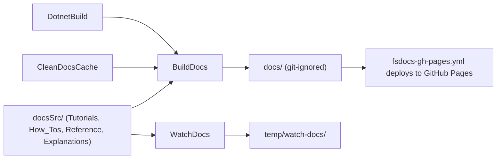

# Documentation site

`fsdocs` generates the MiniScaffold documentation site from `docsSrc/`.
The `BuildDocs` target writes to `docs/`, and `WatchDocs` writes to `temp/watch-docs/` and starts a local server.
`build/FsDocs.fs` wraps `dotnet fsdocs build` and `dotnet fsdocs watch`.



Commands (`docsSrc/How_Tos/build-and-preview-docs.md`):

```bash
./build.sh BuildDocs
./build.sh WatchDocs
```

## Structure

`docsSrc/` follows the Divio system (`docsSrc/Explanations/Documentation_System.md`):

| Directory | Reader need |
| --- | --- |
| `Tutorials/` | Learn through a complete example |
| `How_Tos/` | Complete a specific task |
| `Reference/` | Find exact options, commands, or file descriptions |
| `Explanations/` | Understand a design and its reasons |

Each directory has a `0-toc.md` with links to its pages. Page front matter sets `category`, `categoryindex`, and `index`.
The guides and references use Simplified Technical English: short sentences, active voice, and one instruction in each step.

## Build parameters

`build.fs` passes `fsdocs-collection-name`, `fsdocs-repository-branch`, `fsdocs-repository-link`, `fsdocs-package-version`, and links to `README.md`, `CHANGELOG.md`, and `LICENSE.md`.
The site URL is `https://www.jimmybyrd.me/MiniScaffold/` (`documentationRootUrl` in `build.fs`).

## Invariants

- `.gitignore` ignores `docs/`, `temp/`, `tmp/`, and `.fsdocs`. Do not put tracked files in a directory named `docs`.
- The build project targets net8.0, so the docs build needs the .NET 8 runtime (`build-and-preview-docs.md`).

## Related

- [fake-targets.md](fake-targets.md)
- [../ci/workflows.md](../ci/workflows.md)
- [../template/library-output.md](../template/library-output.md) - the generated library has its own docs build.
