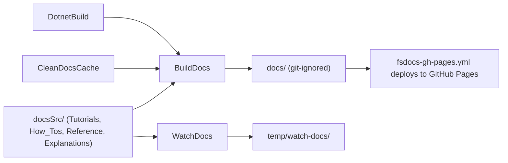

# Documentation site

`fsdocs` generates the MiniScaffold documentation site from `docsSrc/`.
The `BuildDocs` target writes to `docs/`, and `WatchDocs` writes to `temp/watch-docs/` and starts a local server.
`build/FsDocs.fs` wraps `dotnet fsdocs build` and `dotnet fsdocs watch`.



Commands (`docsSrc/How_Tos/build-and-preview-docs.md`):

```bash
./build.sh BuildDocs
./build.sh WatchDocs
```

## Structure

`docsSrc/` follows the Divio system (`docsSrc/Explanations/Documentation_System.md`):

| Directory | Reader need |
| --- | --- |
| `Tutorials/` | Learn through a complete example |
| `How_Tos/` | Complete a specific task |
| `Reference/` | Find exact options, commands, or file descriptions |
| `Explanations/` | Understand a design and its reasons |

Each directory has a `0-toc.md` with links to its pages. Page front matter sets `category`, `categoryindex`, and `index`.
The guides and references use Simplified Technical English: short sentences, active voice, and one instruction in each step.

## Build parameters

`build.fs` passes `fsdocs-collection-name`, `fsdocs-repository-branch`, `fsdocs-repository-link`, `fsdocs-package-version`, and links to `README.md`, `CHANGELOG.md`, and `LICENSE.md`.
The site URL is `https://www.jimmybyrd.me/MiniScaffold/` (`documentationRootUrl` in `build.fs`).

## Page template

`docsSrc/_template.html` and `Content/Library/docsSrc/_template.html` keep the Bootstrap layout of fsdocs 18 and follow the fsdocs-tool 22 script contracts:

```html
<html lang="en" data-bs-theme="auto" data-root="{{root}}">
<button id="search-btn" ...>Search</button>
<dialog id="fsdocs-search"><input type="search" /> <div class="results"><ul></ul><p class="empty"></p></div></dialog>
<script type="module" src="{{root}}content/fsdocs-search.js"></script>
```

- `fsdocs-search.js` is an ES module. It reads `data-root`, loads `index.json`, opens the first `<dialog>` from `#search-btn`, `/`, or `Ctrl+K`, and hides `#search-btn` when `index.json` does not load.
- `fsdocs-tips.js` opens each API tooltip with the popover API. `fsdocs-main.css` hides `div.fsdocs-tip`, so `fsdocs-custom.css` shows `div.fsdocs-tip:popover-open`.
- fsdocs 20 removed `FsDocsNavbarPosition`, so the templates link `content/navbar-fixed-left.css` directly.
- fsdocs 20 removed `<FsDocsCollectionNameLink>`. The generated library `build.fs` passes `fsdocs-collection-name-link` (the GitHub repository URL) as a parameter. The root template does not use the key.
- `{{fsdocs-source-filename}}` stays unresolved in the "Edit this page" link of API reference pages. The base template with fsdocs 18 had the same gap. [Issue #366](https://github.com/TheAngryByrd/MiniScaffold/issues/366) tracks the fix.
- The `MyCoolLib` generated build case checks the generated site with ``docs have no unresolved substitutions`` and ``docs use the fsdocs search contract`` (`Asserts.fs`).

## Invariants

- `.gitignore` ignores `docs/`, `temp/`, `tmp/`, and `.fsdocs`. Do not put tracked files in a directory named `docs`.
- The build project targets net10.0, so the docs build needs the .NET 10 runtime in addition to SDK 11 (`build-and-preview-docs.md`).

## Related

- [fake-targets.md](fake-targets.md)
- [../ci/workflows.md](../ci/workflows.md)
- [../template/library-output.md](../template/library-output.md) - the generated library has its own docs build.
