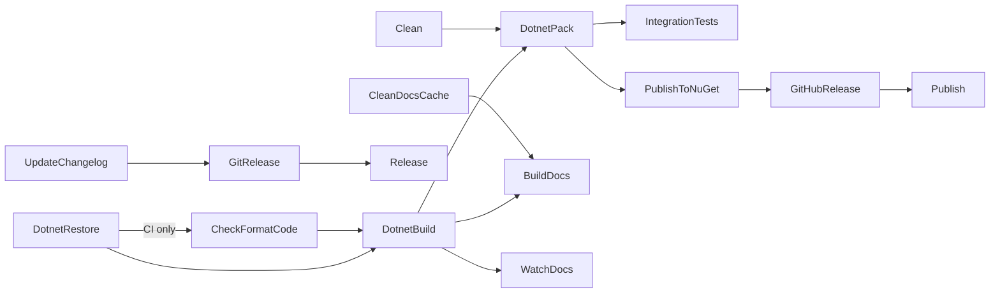

# FAKE targets

`build/build.fs` declares the root targets. The default target is `DotnetPack`.

## Target graph

```fsharp
"DotnetRestore"
=?> ("CheckFormatCode", isCI.Value)
==> "DotnetBuild"
==>! "DotnetPack"

"DotnetPack"
==>! "IntegrationTests"

"DotnetPack"
==> "PublishToNuGet"
==> "GitHubRelease"
==>! "Publish"
```



Soft orderings (`?=>`): `Clean` before `DotnetRestore`, and `DotnetRestore` before `UpdateChangelog` before `DotnetBuild`.

## Target facts

- `Clean ==> DotnetPack`, so each pack, and each `IntegrationTests` run, cleans first.
- `Release` (comment: "For local") runs `UpdateChangelog` and `GitRelease`. It does not build or pack.
- `Publish` (comment: "For CI") packs, pushes to NuGet, and creates the GitHub release.
- `RevertChangelog` is a build-failure target and `DeleteChangelogBackupFile` is a final target. The source states: `// Do NOT put this in the dependency chain`.
- `FormatCode` and `CheckFormatCode` run Fantomas. `CheckFormatCode` treats Fantomas exit code 99 as "needs formatting".
- FAKE matches target names without case (`StringComparer.OrdinalIgnoreCase` in Fake.Core.Target). The docs workflow calls `builddocs` for the `BuildDocs` target.

## Build inputs

| Input | Effect | Source |
| --- | --- | --- |
| `CONFIGURATION` | Defaults to `Release` when `PublishToNuGet` runs, else `Debug` | `build.fs` `configuration` |
| `CI` | Enables `CheckFormatCode`, restore retries, focused-test failure, and the publish gate | `build.fs` `isCI` |
| `GITHUB_TOKEN`, `NUGET_TOKEN` | Credentials for release targets. The build masks both in logs | `build.fs` `TraceSecrets.register` |
| `RELEASE_TAG` | Must equal `v<NuGetVersion>` for publish targets | `build.fs` `allPublishChecks` |
| `RELEASE_VERSION` | Version for `UpdateChangelog` when no argument gives it | `build/Changelog.fs` |
| `MINISCAFFOLD_TEST_PARTITION` | Selects a test partition | [../tests/test-partitions.md](../tests/test-partitions.md) |
| `MINISCAFFOLD_NUPKG_LOCATION` | The package that the tests install | [../tests/integration-tests.md](../tests/integration-tests.md) |

`disableBinLog` sets `DisableInternalBinLog`. The source states the reason: "So we don't require always being on the latest MSBuild.StructuredLogger".

## Common commands

Target names from `build/build.fs`. `.github/workflows/build.yml` runs `IntegrationTests`:

```bash
./build.sh                    # DotnetPack
./build.sh IntegrationTests
./build.sh FormatCode
./build.sh CheckFormatCode
./build.sh BuildDocs
```

## Related

- [release-and-publish.md](release-and-publish.md)
- [msbuild-infrastructure.md](msbuild-infrastructure.md)
- [../template/library-output.md](../template/library-output.md) - the generated library has a similar graph.
