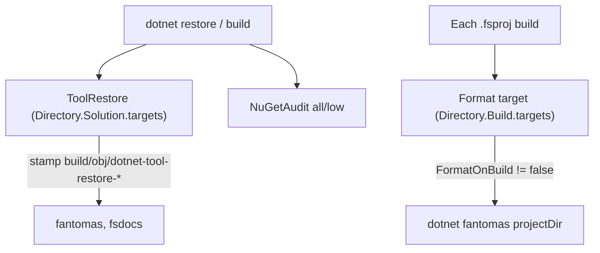

# MSBuild infrastructure

The root `Directory.*` files apply to every project in `MiniScaffold.slnx` (`tests/MiniScaffold.Tests` and `build/build.fsproj`).
`Content/Library/` and `Content/Console/` carry their own copies of these files for generated repositories.

| File | Role |
| --- | --- |
| `Directory.Build.props` | `GenerateAssemblyInfo=false` and NuGet audit settings |
| `Directory.Build.targets` | Incremental Fantomas format on build |
| `Directory.Solution.targets` | Incremental `dotnet tool restore` before restore |
| `Directory.Packages.props` | Central package management and lock files |
| `NuGet.config` | Clears sources and maps all packages to nuget.org |
| `global.json` | SDK `10.0.100`, `rollForward: latestMinor` |
| `.config/dotnet-tools.json` | `fantomas` 7.0.3 and `fsdocs-tool` 18.1.0 |



## Tool restore

`ToolRestore` runs before `_LoadRestoreGraphEntryPoints`, `Restore`, and `CollectPackageReferences`.
Its inputs are `.config/dotnet-tools.json`, `global.json`, `Directory.Solution.targets`, and `Directory.Build.targets`.
It writes a stamp in `build/obj/`, so it runs again only when an input changes.

## Format on build

```xml
<Target Name="Format"
  Condition="'$(MSBuildProjectExtension)' == '.fsproj' AND '$(DesignTimeBuild)' != 'true' AND '$(FormatOnBuild)' != 'false'"
  DependsOnTargets="ToolRestore;_CollectFormatInputs"
  Inputs="@(_FormatInput);$(_DotnetFantomasInputsFile)" Outputs="$(_DotnetFantomasOutputFile)">
```

- A multi-target project formats once, in the outer build.
- `Clean` removes the format stamps.
- `build.sh` and `build.cmd` pass `-p:FormatOnBuild=false` only to `build/build.fsproj`. The solution build in `DotnetBuild` formats code.
- On CI, `CheckFormatCode` runs before `DotnetBuild`, so unformatted code fails before the build can change it.
- `.editorconfig` sets the Fantomas style: max line length 100 and Stroustrup brackets. `.fantomasignore` ignores `AssemblyInfo.fs`.

## NuGet audit

```xml
<NuGetAudit>true</NuGetAudit>
<NuGetAuditMode>all</NuGetAuditMode>
<NuGetAuditLevel>low</NuGetAuditLevel>
<WarningsNotAsErrors>$(WarningsNotAsErrors);NU1901;NU1902</WarningsNotAsErrors>
<WarningsAsErrors Condition="'$(CI)' == 'true'">$(WarningsAsErrors);NU1903;NU1904</WarningsAsErrors>
```

High and critical advisories (NU1903, NU1904) fail the build only when `CI` is exactly `true`.
`AuditPolicyTests.fs` checks this policy for the root and the generated repositories. See [../tests/policy-tests.md](../tests/policy-tests.md).

## Packages

- `Directory.Packages.props` sets `ManagePackageVersionsCentrally`, `RestorePackagesWithLockFile`, and `DisableImplicitFSharpCoreReference`.
- The root does not set `RestoreLockedMode`. `packages.lock.json` and `build/packages.lock.json` are tracked.
- `.gitignore` ignores `Content/**/packages.lock.json`.

## Related

- [fake-targets.md](fake-targets.md)
- [../practices.md](../practices.md)
