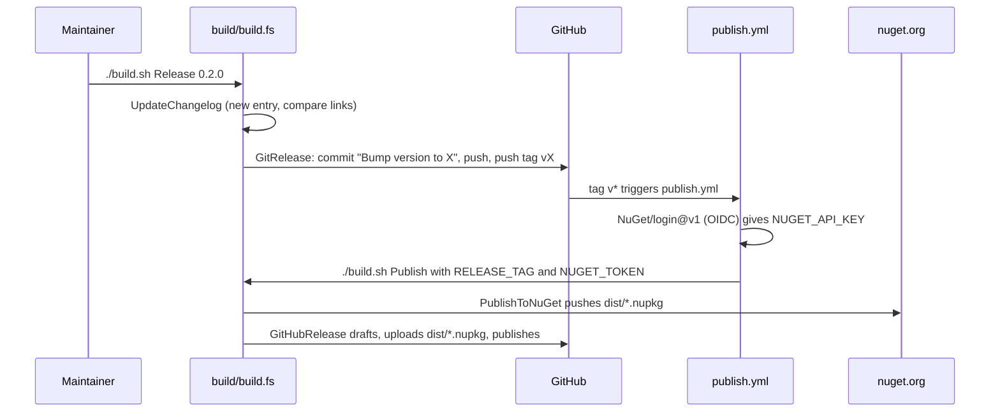

# Release and publish

MiniScaffold takes its package version from `CHANGELOG.md`.
A maintainer creates the release commit and tag locally. GitHub Actions publish the package on the tag.
`docsSrc/How_Tos/release-a-nuget-package.md` is the human guide.



## Version

`build.fs` loads `CHANGELOG.md` with `Fake.Core.Changelog.load` and uses `latestEntry.NuGetVersion`.
The build passes it as `/p:PackageVersion` to build and pack. Pack also sets `PackageReleaseNotes` from `Changelog.mkReleaseNotes`.

## UpdateChangelog

- Reads the version from the first argument or `RELEASE_VERSION` (`build/Changelog.fs`).
- Moves `Unreleased` items and merged prerelease changes into a new dated entry.
- Rejects a version that exists or is older than an existing entry.
- Backs up the file and activates `RevertChangelog`, which restores the file if a later step fails.

## GitRelease

`allReleaseChecks` requires branch `master` and a non-empty changelog.

```fsharp
let tagFromVersionNumber versionNumber = sprintf "v%s" versionNumber
```

`gitRelease` commits `CHANGELOG.md`, deactivates `RevertChangelog`, pushes, and then pushes the tag to `origin`.

## Publish guard

`allPublishChecks` guards `PublishToNuGet` and `GitHubRelease`:

1. `CI` must be set. Otherwise the build fails with "Not on CI. If you want to publish, please use CI."
2. `RELEASE_TAG` must equal `v<NuGetVersion>`. Otherwise it fails with "RELEASE_TAG must equal ...".
3. The latest changelog entry must not be empty.

`GitHubRelease` marks the release as prerelease when the SemVer has a prerelease part.

## Trusted publishing

`.github/workflows/publish.yml` runs on `v*` tags in environment `nuget` with `contents: write` and `id-token: write`.

```yaml
- name: NuGet login
  id: nuget_login
  uses: NuGet/login@v1
  with:
    user: ${{ vars.NUGET_USER }}
- name: publish
  env:
    RELEASE_TAG: ${{ github.ref_name }}
    NUGET_TOKEN: ${{ steps.nuget_login.outputs.NUGET_API_KEY }}
```

`README.md` lists the nuget.org policy fields: owner `TheAngryByrd`, repository `MiniScaffold`, workflow `publish.yml`, environment `nuget`.
The workflow has no stored-key fallback (`README.md`).

## Tests

`ReleasePolicyTests.fs` and `TrustedPublishingTests.fs` check this contract. See [../tests/policy-tests.md](../tests/policy-tests.md).

## Related

- [fake-targets.md](fake-targets.md)
- [Issue #321](https://github.com/TheAngryByrd/MiniScaffold/issues/321) - the open rollout steps for trusted publishing.
- [../template/library-output.md](../template/library-output.md) - the generated library uses the same contract.
