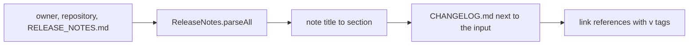

# Release notes script

`tools/releaseToChangelog.fsx` converts a FAKE `RELEASE_NOTES.md` file to a Keep a Changelog `CHANGELOG.md`.
It serves repositories generated before MiniScaffold 0.23.0, which kept the release history in `RELEASE_NOTES.md`.
No build target calls it. Users download it and run it once. `docsSrc/How_Tos/move-release-notes-to-a-changelog.md` is the human guide.

Usage (from the how-to page):

```bash
dotnet fsi releaseToChangelog.fsx MyGithubUsername MyCoolNewLib RELEASE_NOTES.md
```



## Contract

- The script writes `CHANGELOG.md` in the directory of the input file. It refuses to replace an existing `CHANGELOG.md`.
- It exits 1 with a message on stderr when the arguments are wrong, the input is missing, or FAKE finds no version.
- Titles map to sections: `FEATURE` to Added, `BUGFIX` to Fixed, `MINOR` and `MAINTENANCE` to Changed. An untitled note goes to Changed. Another title becomes a custom section.
- The output has an empty `## [Unreleased]` section.
- Link references use `v<version>` tags, the format that `GitRelease` pushes: `compare/v<older>...v<newer>` and `releases/tag/v<oldest>`.

## Invariants

- The `#r "nuget: Fake.Core.ReleaseNotes, <version>"` line must equal `FakeVersion` in `Directory.Packages.props`. A test enforces it.
- Fantomas formats `tools/*.fsx`. `.fantomasignore` excludes only `AssemblyInfo.fs`.

## Tests

`tests/MiniScaffold.Tests/ReleaseToChangelogTests.fs` holds the "release notes to changelog" list. It runs in the `other` partition.
The tests run the script on a sample file, check the sections and links, check the error paths, and check the version pin.

## Related

- [release-and-publish.md](release-and-publish.md)
- [../practices.md](../practices.md)
