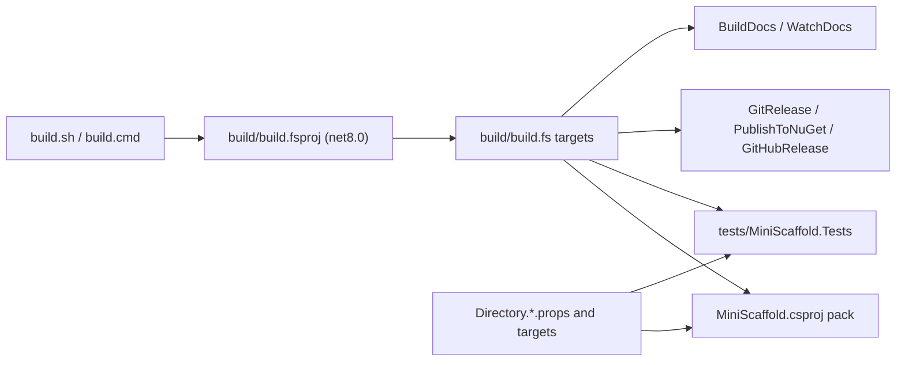

# Build domain

The build domain is the root FAKE build in `build/` and the MSBuild files at the repository root.
`build.sh` and `build.cmd` run the FAKE build project, which packs the template, runs the integration tests, releases, and builds the documentation site.



Entry point (`build.sh`):

```bash
dotnet run --project ./build/build.fsproj -p:FormatOnBuild=false -v:m -- -t "$@"
```

`build.cmd` runs the same command without `-v:m`.

## Topics

- [fake-targets.md](fake-targets.md) - the target graph, the default target, and the build inputs.
- [release-and-publish.md](release-and-publish.md) - version, tag, NuGet trusted publishing, and the GitHub release.
- [template-package.md](template-package.md) - how `MiniScaffold.csproj` packs `Content/`.
- [msbuild-infrastructure.md](msbuild-infrastructure.md) - tool restore, format on build, NuGet audit, and central package management.
- [documentation-site.md](documentation-site.md) - the fsdocs site from `docsSrc/`.

## Related

- [../ci/summary.md](../ci/summary.md)
- [../tests/summary.md](../tests/summary.md)
