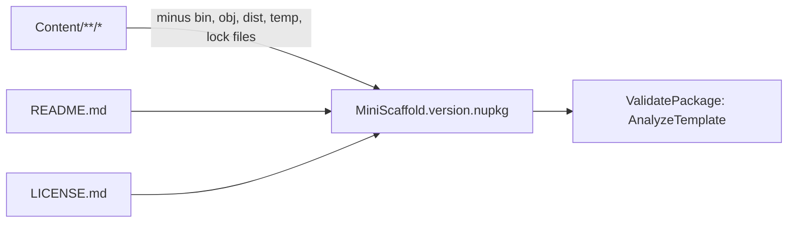

# Template package

`MiniScaffold.csproj` packs `Content/` into a `Template` NuGet package. It compiles no code.

```xml
<Content
    Include="Content/**/*"
    Exclude="Content/**/.paket/paket;Content/**/.paket/.store/*;Content/**/packages/**/*;Content/**/.fake/**;Content/**/bin/**/**/*;Content/**/dist/*;Content/**/temp/*;Content/**/bin/**/**/*;Content/**/obj/**/**/*;Content/**/paket-files/**;Content/**/packages.lock.json">
    <PackagePath>Content\</PackagePath>
</Content>
```



## Properties

- `PackageType` is `Template`. `NoBuild` is `true` and `IncludeBuildOutput` is `false`.
- `NoDefaultExcludes` is `true`. The source comment states the reason: "So nuget will include .files".
- `TargetFramework` is `netstandard0.0`. `NoWarn` includes `NU5128`, because the package is not a library package (source comment).
- `EnablePackageValidation` is `true`.
- `README.md` and `LICENSE.md` go to the package root.

## Validation

The `ValidatePackage` target runs after `Pack`. It calls `AnalyzeTemplate` from `Sayedha.Templates.Tasks` on the new package.

## Invariants

- Generated-repository artifacts (`bin`, `obj`, `dist`, `temp`, `packages.lock.json`) must not enter the package. The `Exclude` list enforces this.
- The build passes `PackageVersion` from `CHANGELOG.md`. See [release-and-publish.md](release-and-publish.md).
- The package description in `MiniScaffold.csproj` still names .NET 6.0. The template content targets net8.0, net9.0, and net10.0.

## Related

- [../template/summary.md](../template/summary.md)
- [../tests/integration-tests.md](../tests/integration-tests.md) - the tests install this package.
