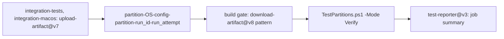

# Action versions and devcontainer features

The root workflows and the generated workflows use the same major version of each action.
The generated workflows are under `Content/Library/.github/workflows/` and `Content/Console/.github/workflows/`.
No check compares the two sets. [Issue #358](https://github.com/TheAngryByrd/MiniScaffold/issues/358) adds Dependabot for them.

| Action | Major | Root files | Generated files |
| --- | --- | --- | --- |
| `actions/checkout` | `v7` | all workflows | all workflows |
| `actions/setup-dotnet` | `v6` | all workflows | all workflows |
| `actions/upload-artifact` | `v7` | `build.yml`, `.github/actions/integration-workload` | none |
| `actions/download-artifact` | `v8` | `build.yml` gate job | none |
| `actions/github-script` | `v9` | `publish.yml` `set_version` | none |
| `dorny/test-reporter` | `v3` | `build.yml` | `build.yml` |
| `actions/configure-pages` | `v6` | `fsdocs-gh-pages.yml` | Library `fsdocs-gh-pages.yml` |
| `actions/upload-pages-artifact` | `v5` | `fsdocs-gh-pages.yml` | Library `fsdocs-gh-pages.yml` |
| `actions/deploy-pages` | `v5` | `fsdocs-gh-pages.yml` | Library `fsdocs-gh-pages.yml` |
| `NuGet/login` | `v1` | `publish.yml` | Library `publish.yml` |
| `devcontainers/ci` | `v0.3` | `build.yml` devcontainer jobs | `build.yml` `build-devcontainer` |



## Artifact contracts

- `download-artifact@v8` with `pattern` and no `merge-multiple` puts each artifact in `<path>/<artifact name>/` when two or more artifacts match. When one artifact matches, it extracts that artifact directly into `<path>`.
- `Verify` finds the bundles with a recursive search for `manifest.json` (`build/TestPartitions.ps1`), so both layouts work. Each OS and configuration has two or more partitions.
- `download-artifact@v8` fails the step on a digest mismatch (`digest-mismatch: error` is the default).
- `upload-artifact@v7` zips the upload (`archive: true` is the default) and excludes hidden files (`include-hidden-files: false`). The partition evidence files have no leading dot.
- `upload-pages-artifact@v5` excludes hidden files (`include-hidden-files: false` is the default).

## Other contracts

- `setup-dotnet@v6` with `global-json-file` reads `rollForward`. For `latestMinor` it requests the newest SDK of the major version. Root `publish.yml` and `fsdocs-gh-pages.yml` therefore install the newest SDK of the `global.json` major, as the `build.yml` jobs do. `setup-dotnet@v4` requested the exact `global.json` version for each value except `latestFeature`. The change came in `setup-dotnet@v5.3.0`.
- `setup-dotnet@v6` installs the newest matching SDK online by default. It reuses a local SDK only when the effective `check-latest` is `false` and a local SDK matches. The `check-latest` input wins over `DOTNET_CHECK_LATEST`.
- `test-reporter@v3` writes the report to the job summary (`use-actions-summary: true` is the default). It does not create a check run, so it does not need `checks: write`, and it works with the read-only token of a fork pull request.
- In summary mode, `test-reporter@v3` makes no file annotations and does not show the `name` input. The report starts with a heading that has the pass, fail, and skip counts. `report-title` adds an optional custom title, and no workflow sets it.
- For a report larger than 1 MiB, `test-reporter@v3` lists only the failed tests. If the report is still too large, it trims the report.
- `test-reporter@v3` fails the step when a test fails (`fail-on-error: true`) or when no file matches (`fail-on-empty: true`).
- `checkout@v7` writes the persisted Git credentials to a file under `$RUNNER_TEMP` and removes it in the post step. It refuses fork pull request code for `pull_request_target` and `workflow_run`. No workflow here uses those events.
- The `github-script@v9` script in `publish.yml` uses only `context` and `core`. Version 9 removed `require('@actions/github')`.
- The JavaScript actions in the table run on Node.js 24. `upload-pages-artifact@v5` is a composite action that calls `upload-artifact@v7`. A self-hosted runner needs version 2.327.1 or later, and 2.329.0 or later for authenticated Git inside a Docker container action.

Example from `.github/workflows/build.yml`:

```yaml
      - name: Download partition evidence
        uses: actions/download-artifact@v8
        with:
          pattern: partition-${{ matrix.os }}-${{ matrix.configuration }}-*-${{ github.run_id }}-${{ github.run_attempt }}
          path: ${{ runner.temp }}/partitions
```

## Devcontainer features

`.devcontainer/devcontainer.json`, `Content/Library/.devcontainer/devcontainer.json`, and `Content/Console/.devcontainer/devcontainer.json` have the same features.
The starship feature uses the `ghcr.io/devcontainers-extra/features` namespace. The `devcontainers-contrib` namespace is the old name.
Each ID in `overrideFeatureInstallOrder` must be a key of `features` without its version tag. The devcontainer CLI does not compare the two lists, and an ID that matches no feature has no effect on the install order.

```json
"ghcr.io/devcontainers/features/common-utils:2": { },
"ghcr.io/devcontainers/features/github-cli:1": {},
"ghcr.io/devcontainers-extra/features/starship:1": {},
"ghcr.io/devcontainers/features/dotnet:2": { }
```

Root `build.yml` builds each devcontainer. Each `devcontainers/ci` step sets `push: never`, because the jobs set no `imageName` and the default `push: filter` reports an error on a push to `master`.

- `build-devcontainer` builds the root devcontainer and runs `./build.sh` in it.
- `build-template-devcontainer` builds `Content/Library` and `Content/Console` with the `subFolder` input and runs `dotnet --info` and `starship --version` in each, after `set -e`. `devcontainers/ci` runs `runCmd` with `bash -c`, so without `set -e` only the last command sets the result.
- The gate job `build` does not need the devcontainer jobs. A failed devcontainer job does not fail a required check.

## Lessons

- Run `actionlint` on each changed workflow. The `Content/` workflows are workflow files too.
- Read the release note of each minor release between the two majors, then the source. The `setup-dotnet` `rollForward` change is in the `v5.3.0` note, not in a major note. The `download-artifact` single-match layout for `pattern` is in no release note.

## Related

- [workflows.md](workflows.md)
- [../tests/test-partitions.md](../tests/test-partitions.md)
- [../template/library-output.md](../template/library-output.md)
