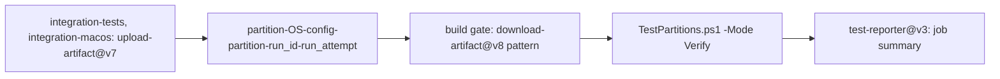

# Action versions and devcontainer features

The root workflows and the generated workflows use the same major version of each action.
The generated workflows are under `Content/Library/.github/workflows/` and `Content/Console/.github/workflows/`.
No check compares the two sets. Dependabot opens one version-update pull request for each action across all copies, unless the copies have incompatible versions (see [dependency-updates.md](dependency-updates.md)).

| Action | Major | Root files | Generated files |
| --- | --- | --- | --- |
| `actions/checkout` | `v7` | all workflows | all workflows |
| `actions/setup-dotnet` | `v6` | all workflows | all workflows |
| `actions/upload-artifact` | `v7` | `build.yml`, `.github/actions/integration-workload` | none |
| `actions/download-artifact` | `v8` | `build.yml` gate job | none |
| `actions/github-script` | `v9` | `publish.yml` `set_version` | none |
| `dorny/test-reporter` | `v3` | `build.yml` | `build.yml` |
| `actions/configure-pages` | `v6` | `fsdocs-gh-pages.yml` | Library `fsdocs-gh-pages.yml` |
| `actions/upload-pages-artifact` | `v5` | `fsdocs-gh-pages.yml` | Library `fsdocs-gh-pages.yml` |
| `actions/deploy-pages` | `v5` | `fsdocs-gh-pages.yml` | Library `fsdocs-gh-pages.yml` |
| `NuGet/login` | `v1` | `publish.yml` | Library `publish.yml` |
| `devcontainers/ci` | `v0.3` | `build.yml` devcontainer jobs | `build.yml` `build-devcontainer` |



## Artifact contracts

- `download-artifact@v8` with `pattern` and no `merge-multiple` puts each artifact in `<path>/<artifact name>/` when two or more artifacts match. When one artifact matches, it extracts that artifact directly into `<path>`.
- `Verify` finds the bundles with a recursive search for `manifest.json` (`build/TestPartitions.ps1`), so both layouts work. Each OS and configuration has two or more partitions.
- `download-artifact@v8` fails the step on a digest mismatch (`digest-mismatch: error` is the default).
- `upload-artifact@v7` zips the upload (`archive: true` is the default) and excludes hidden files (`include-hidden-files: false`). The partition evidence files have no leading dot.
- `upload-pages-artifact@v5` excludes hidden files (`include-hidden-files: false` is the default).

## Other contracts

- `setup-dotnet@v6` with `global-json-file` reads `rollForward`. For `latestMinor` it requests the newest SDK of the major version. Root `publish.yml` and `fsdocs-gh-pages.yml` therefore install the newest SDK of the `global.json` major, as the `build.yml` jobs do. `setup-dotnet@v4` requested the exact `global.json` version for each value except `latestFeature`. The change came in `setup-dotnet@v5.3.0`.
- `setup-dotnet@v6` installs the newest matching SDK online by default. It reuses a local SDK only when the effective `check-latest` is `false` and a local SDK matches. The `check-latest` input wins over `DOTNET_CHECK_LATEST`.
- `test-reporter@v3` writes the report to the job summary (`use-actions-summary: true` is the default). It does not create a check run, so it does not need `checks: write`, and it works with the read-only token of a fork pull request.
- In summary mode, `test-reporter@v3` makes no file annotations and does not show the `name` input. The report starts with a heading that has the pass, fail, and skip counts. `report-title` adds an optional custom title, and no workflow sets it.
- For a report larger than 1 MiB, `test-reporter@v3` lists only the failed tests. If the report is still too large, it trims the report.
- `test-reporter@v3` fails the step when a test fails (`fail-on-error: true`) or when no file matches (`fail-on-empty: true`).
- `checkout@v7` writes the persisted Git credentials to a file under `$RUNNER_TEMP` and removes it in the post step. It refuses fork pull request code for `pull_request_target` and `workflow_run`. No workflow here uses those events.
- The `github-script@v9` script in `publish.yml` uses only `context` and `core`. Version 9 removed `require('@actions/github')`.
- The JavaScript actions in the table run on Node.js 24. `upload-pages-artifact@v5` is a composite action that calls `upload-artifact@v7`. A self-hosted runner needs version 2.327.1 or later, and 2.329.0 or later for authenticated Git inside a Docker container action.

Example from `.github/workflows/build.yml`:

```yaml
      - name: Download partition evidence
        uses: actions/download-artifact@v8
        with:
          pattern: partition-${{ matrix.os }}-${{ matrix.configuration }}-*-${{ github.run_id }}-${{ github.run_attempt }}
          path: ${{ runner.temp }}/partitions
```

## Devcontainer features

`.devcontainer/devcontainer.json`, `Content/Library/.devcontainer/devcontainer.json`, and `Content/Console/.devcontainer/devcontainer.json` have the same features.
No feature needs the GitHub REST API on its normal path. `common-utils` installs with apt and clones Oh My Zsh with git. `dotnet` uses the .NET install script and Microsoft feeds. `github-cli` (1.1.3, the image that `:1` resolves to) resolves the gh version with `git ls-remote` and downloads `gh_<version>_linux_<arch>.deb` from GitHub Releases, because `installDirectlyFromGitHubRelease` defaults to `true`. If `git ls-remote` gives no version, its installer exits 1 and the build fails. Unreleased code on upstream `main` adds a REST API fallback and a last known version. The feature tags float (`:1`, `:2`), so a later feature version can change these paths.
Each ID in `overrideFeatureInstallOrder` must be a key of `features` without its version tag. The devcontainer CLI does not compare the two lists, and an ID that matches no feature has no effect on the install order.

```json
"ghcr.io/devcontainers/features/common-utils:2": { },
"ghcr.io/devcontainers/features/github-cli:1": {},
"ghcr.io/devcontainers/features/dotnet:2": { }
```

Root `build.yml` builds each devcontainer. Each `devcontainers/ci` step sets `push: never`, because the jobs set no `imageName` and the default `push: filter` reports an error on a push to `master`.

- `build-devcontainer` builds the root devcontainer and runs `./build.sh` in it.
- `build-template-devcontainer` builds `Content/Library` and `Content/Console` with the `subFolder` input and runs `dotnet --info`, `starship --version`, and a check that `command -v starship` is `/usr/local/bin/starship` (the install script location) in each, after `set -e`. `devcontainers/ci` runs `runCmd` with `bash -c`, so without `set -e` only the last command sets the result.
- The gate job `build` does not need the devcontainer jobs. A failed devcontainer job does not fail a required check.

## Starship in the devcontainers

The three devcontainer `Dockerfile`s are the same file. Each installs the latest starship release with the official install script, not with a devcontainer feature:

```dockerfile
RUN curl -sS https://starship.rs/install.sh | sh -s -- --yes && starship --version
```

- The script supports `--version`, and the `Dockerfile` does not pass it, so a build that runs this layer gets the latest release. A fresh CI runner starts with no layer cache and runs it. A second build in the same job, or a local rebuild, can reuse the cached layer and keep the old starship. The script downloads `https://github.com/starship/starship/releases/latest/download/starship-<target>.tar.gz` and makes no `api.github.com` call (`BASE_URL` and `URL` in `install.sh`). The Docker build runs as root, so it writes to `/usr/local/bin` without `sudo`. `--yes` skips the prompt.
- The script needs `tar` and `gzip` for the Linux archive, and the `buildpack-deps:trixie-curl` image has both. It needs `unzip` only for Windows.
- `/bin/sh` runs the pipe without `pipefail`. When curl gets no script (for example a DNS failure), `sh` reads an empty script and exits 0. An HTTP error body runs as a script and fails with a non-zero code (2 for an HTML page, 127 for a plain-text body), and a failed archive download makes the script exit non-zero. The `&& starship --version` part fails the layer in the exit-0 case, so the image build fails and Docker caches no layer without starship.
- Trade-offs: the script and the release are not pinned, so two uncached builds can get different starship versions, and a change of the script reaches the next uncached build. The script extracts the archive with no checksum check. The curl calls set no timeout, and the download and the extraction have no size limit. The script leaves its archive (about 5 MB) in `/tmp` of the image.
- The `ghcr.io/devcontainers-extra/features/starship` feature installs through the `gh-release` feature and nanolayer v0.5.6. nanolayer resolves `latest` from git tags when git is present, and from `https://api.github.com/repos/<repo>/releases` otherwise. For every version it then reads `https://api.github.com/repos/<repo>/releases/tags/<tag>` to find the asset, without a token. The feature has no token option. On a GitHub-hosted runner the shared unauthenticated rate limit can be used up, and the build failed with `HTTP Error 403: rate limit exceeded` at the `releases/tags` call. A fixed version does not remove that call.
- Rejected options: the feature with a fixed version (it still calls `releases/tags`), a token for the feature (no option), the Debian package (trixie has `starship` 1.22.1, older than the latest release, and bookworm has none), and an image cache (`cacheFrom`, the first build still calls the API).
- `onCreateCommand` adds `eval "$(starship init zsh)"` to `~/.zshrc`. It runs as `vscode` after the features, so the install in the Dockerfile does not change the prompt setup.
- `DevcontainerPolicyTests.fs` fails if a non-comment line of a `devcontainer.json` names a starship feature, or if a `Dockerfile` has no active install line (a commented line fails it). The path check in `build-template-devcontainer` fails if another starship is in front of the script one.

## Lessons

- Run `actionlint` on each changed workflow. The `Content/` workflows are workflow files too.
- Read the release note of each minor release between the two majors, then the source. The `setup-dotnet` `rollForward` change is in the `v5.3.0` note, not in a major note. The `download-artifact` single-match layout for `pattern` is in no release note.

## Related

- [workflows.md](workflows.md)
- [../tests/test-partitions.md](../tests/test-partitions.md)
- [../template/library-output.md](../template/library-output.md)
