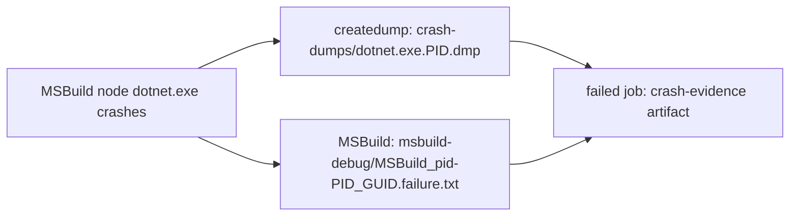

# Crash evidence

The `integration-tests` job keeps evidence of a crashed MSBuild worker node. [Issue #365](https://github.com/TheAngryByrd/MiniScaffold/issues/365) tracks a node that ends with `MSB4166`, `Fatal error.`, and `0xC0000005` in the AltCover `dotnet test` step of a generated console build on `windows-latest`.



## Configuration

```yaml
- name: Build via Windows
  env:
    MSBUILDDEBUGPATH: ${{ runner.temp }}/msbuild-debug
    DOTNET_DbgEnableMiniDump: 1
    DOTNET_DbgMiniDumpType: 1
    DOTNET_DbgMiniDumpName: ${{ runner.temp }}\crash-dumps\%e.%p.dmp
```

- `MSBUILDDEBUGPATH` is set on both build steps. It only moves the `MSBuild_pid-<pid>_<guid>.failure.txt` files out of the MSBuild temp folder (`DebugUtils.cs` in dotnet/msbuild). The full debug output needs `MSBuildDebugEngine`, which stays off.
- The generated builds inherit both variables. `Builds.executeBuild` removes only `MSBuildSDKsPath` and `MSBuildExtensionsPath`.
- The `DOTNET_DbgMiniDump*` variables are set on the Windows build step only. A step before it creates `$RUNNER_TEMP/crash-dumps`, because `createdump` reports "Invalid dump path" for a missing folder.
- `Upload crash evidence` runs on `failure()`. It uploads `msbuild-debug/` and `crash-dumps/dotnet.exe.*.dmp` as `crash-evidence-<os>-<configuration>-<partition>-<run_id>-<run_attempt>`, with `if-no-files-found: ignore`.

## Facts

- The runtime runs `createdump` for a crash (for example an `AccessViolationException`) and also for an unhandled managed exception. The FAKE `build.exe` ends with an unhandled `BuildFailedException` in the tests that fail a build on purpose, so it writes a dump (about 1 s and 10 MB) each time. The upload keeps only `dotnet.exe` dumps.
- A mini dump (type 1) has the module and thread lists, the exception, and all stacks.
- A Windows Error Reporting `LocalDumps\dotnet.exe` key wrote no dump on the GitHub Windows runner. The runtime dump variables did (CI run 45008598923: `dotnet.exe.4076.dmp`, 9.5 MB).
- `Marshal.ReadInt32(nativeint 0x1234567890L)` in `dotnet fsi` reproduces the symptom (`Fatal error.`, exit code `0xC0000005`). A read near address 0 does not, because .NET turns it into a `NullReferenceException`.
- A GitHub `pwsh` step ends with `exit $LASTEXITCODE`, so a step whose last native command crashed fails even when the rest of the script succeeds.

## Related

- [workflows.md](workflows.md)
- [action-versions.md](action-versions.md)
- [summary.md](summary.md)
