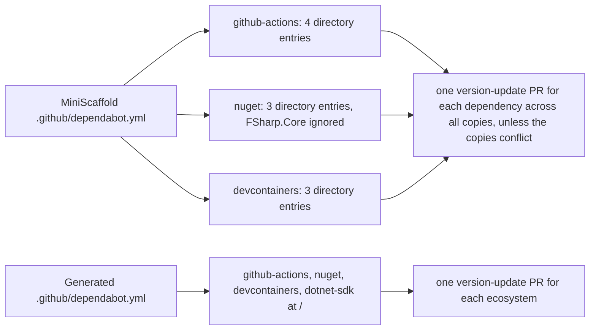

# Dependency updates

`.github/dependabot.yml` keeps the GitHub Actions, the NuGet packages and .NET tools, and the devcontainer features current in the root and in the template content. It runs weekly. Dependabot reads the file from the default branch. The library and console templates also ship a `.github/dependabot.yml` for each generated repository (see [Generated repositories](#generated-repositories)).



## GitHub Actions

```yaml
- package-ecosystem: github-actions
  directories:
    - "/"
    - "/.github/actions/*"
    - "/Content/Library/.github/workflows"
    - "/Content/Console/.github/workflows"
  groups:
    github-actions:
      group-by: dependency-name
```

- dependabot-core (`github_actions/lib/dependabot/github_actions/file_fetcher.rb`, `workflow_files`) scans `/.github/workflows` and a root `action.yml` or `action.yaml` only for the entry `/`. For any other entry, it scans the YAML files in that directory itself. So the template entries name the `workflows` folders. An entry `/Content/Library` finds no workflow, and the schema check still passes.
- The entries find these files: `/` finds the 3 root workflows, `/.github/actions/*` finds `integration-workload/action.yml`, `/Content/Library/.github/workflows` finds 3 workflows, and `/Content/Console/.github/workflows` finds 1. No file is found twice. Each of the 11 external actions has one ref in all its copies.
- `group-by: dependency-name` makes one pull request for each action across all entries, for version updates only. A security update is not grouped. Copies with incompatible version constraints get separate pull requests. A copy that is already at the target version gets no change.
- The workflow updater rewrites the `uses:` reference and a version comment next to a SHA pin. The template token `MyReleaseBranch` is in the `branches` lists, so it does not change. All 7 workflow files and the composite action parse as YAML.
- Dependabot ignores local references such as `./.github/actions/integration-workload` (GitHub docs, "Supported ecosystems and repositories").

## NuGet packages and .NET tools

```yaml
- package-ecosystem: nuget
  directories: ["/", "/Content/Library", "/Content/Console"]
  ignore:
    - dependency-name: FSharp.Core
  groups:
    nuget:
      group-by: dependency-name
```

- The NuGet updater (`nuget/helpers/lib/NuGetUpdater` in dependabot-core) reads the solution and project files at the top of each entry and follows the solution. It supports central package management, so it changes `Directory.Packages.props`. It also reads `.config/dotnet-tools.json` in the entry or a parent folder (`DotNetToolsJsonDiscovery`). After an update, `FileWriterWorker` runs discovery again, which restores the projects. `ModifiedFilesTracker` keeps only files that existed before the update, so a pull request changes the committed `packages.lock.json` files (in MiniScaffold: the root, `build/`, and `tests/MiniScaffold.Tests/`) and adds no new lock file.
- `/` finds `MiniScaffold.slnx` (build and tests) and the root `MiniScaffold.csproj`. The template entries find `MyLib.1.slnx` with the template token names. No entry overlaps another.
- The FSharp.Core ignore applies to every directory of the block, the root included. A second block for the root alone would scope it, but then a package that the root and the templates share would get two pull requests. Update FSharp.Core in the root and in the console template by hand. The generated console repositories update it, because their configuration has no ignore.
- The NuGet updater extracts dependencies from `global.json` only from `msbuild-sdks` (`GlobalJsonBuildFile.cs`). It reads `sdk.version` only to install that SDK (`nuget/updater/common.ps1`). An SDK update needs the `dotnet-sdk` ecosystem, which the root configuration does not use, because the root and the templates pin SDK 11.

## Devcontainer features

```yaml
- package-ecosystem: devcontainers
  directories:
    - "/"
    - "/Content/Library"
    - "/Content/Console"
  groups:
    devcontainer-features:
      group-by: dependency-name
```

- The devcontainers fetcher reads `.devcontainer.json` and `.devcontainer/devcontainer.json` under each entry. Each entry finds one file. It also reads `.devcontainer/<dir>/devcontainer.json`, but outside the root it builds the wrong path for that layout, so keep each template config at `.devcontainer/devcontainer.json`.
- The update checker keeps the precision of the pin and takes the newest matching tag (`devcontainers/lib/dependabot/devcontainers/update_checker.rb`). A major pin such as `ghcr.io/devcontainers/features/dotnet:2` moves to the newest major tag, for example `:4` when `:3` and `:4` exist. It does not check the feature options.
- No `devcontainer-lock.json` exists, so an update commits no lockfile.
- No ecosystem covers the `Dockerfile` base image (`buildpack-deps:${VARIANT}-curl`). The `ARG VARIANT` sets the Debian suite, which the .NET 11 support depends on. Starship is not a feature and has no version to update: the `Dockerfile` runs its install script for the latest release (see [action-versions.md](action-versions.md#starship-in-the-devcontainers)).

## Generated repositories

`Content/Library/.github/dependabot.yml` and `Content/Console/.github/dependabot.yml` ship with the template. Each has one block for each ecosystem, with `directory: "/"` and a weekly schedule. The `github-actions`, `nuget`, and `devcontainers` blocks have one group with `patterns: ["*"]`, so each of them gets one pull request for all its version updates. A group applies to version updates only, so each security update gets its own pull request. `dotnet-sdk` has no group, because `global.json` pins one SDK:

| Ecosystem | Generated manifest |
| --- | --- |
| `github-actions` | `.github/workflows/*.yml` |
| `nuget` | `Directory.Packages.props`, `.config/dotnet-tools.json`, `packages.lock.json` |
| `devcontainers` | `.devcontainer/devcontainer.json` |
| `dotnet-sdk` | `global.json` `sdk.version` (`dotnet_sdk/lib/dependabot/dotnet_sdk/file_updater.rb` replaces the old version string) |

- The library configuration ignores FSharp.Core, because the packed library keeps a low FSharp.Core dependency for its consumers (#353). The console configuration updates it.
- The library restores in locked mode when `CI=true`. The template ships no lock file (`MiniScaffold.csproj` excludes `Content/**/packages.lock.json`), so the generated repository commits the lock files of its first restore. A Dependabot pull request then changes those lock files with `Directory.Packages.props`. A lock file that the repository did not commit stays out of the pull request.
- The `dotnet-sdk` version finder skips prereleases unless `global.json` sets `allowPrerelease`, but it does not stop at the major version (`update_checker/latest_version_finder.rb`). The generated build workflows install only the 10.x and 11.x SDKs, and the devcontainer installs 11.0. So a pull request to a new SDK major fails CI until the workflow `dotnet-version` lists and the devcontainer `dotnet` feature include that SDK. The library TFMs can stay.
- ``dependabot config covers the generated repository`` (`Asserts.fs`) parses the generated file with `DependabotConfig.read` (YamlDotNet), and requires version 2, the four ecosystems once each with `directory: "/"` and a weekly schedule, a manifest for each, one `patterns: ["*"]` group for each ecosystem except `dotnet-sdk`, and an ignore of all versions of exactly the expected NuGet packages. The `MyCoolLib` and `MyCoolApp` cases run it.

## Review of a Dependabot pull request

- Tests must not pin an action tag. `TrustedPublishingTests.fs` accepts any `NuGet/login@v<major>` and rejects another action, so a Dependabot major update of `NuGet/login` passes it.
- The Major column in [action-versions.md](action-versions.md) is a copy of the workflow refs. Update it in the Dependabot pull request, or after its merge. The same applies to the prose that names `NuGet/login@v1` (`README.md`, `Content/Library/README.md`, `docsSrc`, and the lode).
- Each action or feature gets its own pull request, and each runs the full CI matrix.
- A root pull request that changes `FakeVersion` in `Directory.Packages.props` must also change the `#r "nuget: Fake.Core.ReleaseNotes, ..."` line of `tools/releaseToChangelog.fsx`. `ReleaseToChangelogTests.fs` fails until both agree.
- A generated library pins FSharp.Core with transitive pinning and ignores its updates. If a new FAKE or Expecto version requires a newer FSharp.Core, its restore fails with a downgrade error, and the grouped pull request fails CI. Decide the FSharp.Core minimum again before you merge it.
- `Directory.Solution.targets` runs `dotnet tool restore` before each restore, also in the Dependabot restore. If the tool restore fails, all NuGet updates of that run fail.
- The `dotnet-sdk` updater replaces each occurrence of the old version string in `global.json`. If an `msbuild-sdks` value has the same version, it changes too.
- A devcontainer feature major can change its options. The `dotnet` feature takes `version: "11.0"` and `additionalVersions: "10.0"`. `build-template-devcontainer` runs `dotnet --info`, which passes with any SDK, and the gate job `build` does not need the devcontainer jobs. Before a feature major merges, check the feature options and the installed SDKs in the devcontainer job log.

## Schema check

```powershell
Invoke-WebRequest https://www.schemastore.org/dependabot-2.0.json -OutFile dependabot-2.0.schema.json
py -c "import yaml, json; json.dump(yaml.safe_load(open('.github/dependabot.yml')), open('dependabot.json', 'w'))"
Test-Json -Path dependabot.json -SchemaFile dependabot-2.0.schema.json
```

`Test-Json -SchemaFile` takes a local file, not a URL. The schema check does not find a wrong directory entry. The `DependabotPolicy` tests do. On a pull request that changes the file, the Dependabot app also runs a check named `.github/dependabot.yml` with the title "Dependabot config file validation". Update jobs read the file from the default branch.

## Invariants

- Each tracked manifest must be read by an entry, by the fetcher rules above, and each entry must read a manifest. `tests/MiniScaffold.Tests/DependabotPolicyTests.fs` lists the tracked files with `git ls-files`, finds the manifests (files in a `.github/workflows` folder, `action.yml` and `action.yaml`, `.devcontainer.json`, `.devcontainer/[<dir>/]devcontainer.json`, and `Directory.Packages.props`), and parses the configuration with `DependabotConfig.read` (YamlDotNet), so flow and block YAML forms read the same. A missing or moved entry, an entry with no manifest, a new composite action, or a new devcontainer without an entry fails it. A nested devcontainer config outside the root also fails it, because Dependabot does not read it.

## Related

- [action-versions.md](action-versions.md)
- [workflows.md](workflows.md)
- [summary.md](summary.md)
