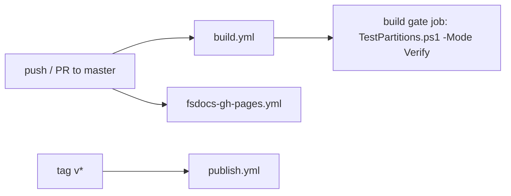

# CI domain

The CI domain is the GitHub Actions configuration of the root repository in `.github/`.
The generated repositories have their own workflows under `Content/*/.github/`. See [../template/library-output.md](../template/library-output.md).

| Workflow | Trigger | Job |
| --- | --- | --- |
| `.github/workflows/build.yml` ("Build master") | Push and pull request to `master` | Partitioned integration tests, ARM64 checks, coverage gate |
| `.github/workflows/publish.yml` | Tags `v*` | `./build.sh Publish` with NuGet trusted publishing |
| `.github/workflows/fsdocs-gh-pages.yml` | Push to `master`, `workflow_dispatch` | `./build.sh builddocs` and GitHub Pages deploy |



Publish command (`.github/workflows/publish.yml`):

```bash
chmod +x ./build.sh
./build.sh Publish
```

## Topics

- [workflows.md](workflows.md) - the jobs, matrices, and gate of `build.yml`.

## Other `.github` files

- `.github/actions/integration-workload/action.yml` - a composite action that runs one macOS integration partition. See [workflows.md](workflows.md).
- `.github/ISSUE_TEMPLATE*`, `.github/PULL_REQUEST_TEMPLATE.md`, `.github/FUNDING.yml` - GitHub community files.

## Related

- [../build/release-and-publish.md](../build/release-and-publish.md)
- [../tests/test-partitions.md](../tests/test-partitions.md)
