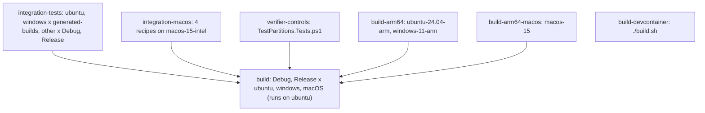

# Build workflow

`.github/workflows/build.yml` runs the integration tests in partitions and then verifies that the partitions cover all tests.
Each test job installs SDKs 8.x, 9.x, and 10.x.



## Jobs

- `integration-tests` runs `./build.sh IntegrationTests` or `./build.cmd IntegrationTests` with `CI: true`, `MINISCAFFOLD_TEST_PARTITION`, and `MINISCAFFOLD_TEST_OS`.
  It uploads `TestResults/partitions/<partition>/` as partition evidence and `TestResults/generated-builds/**` as diagnostics.
- `integration-macos` runs up to three workloads in sequence through `.github/actions/integration-workload`, with a clean checkout between workloads.
  The action sets `MINISCAFFOLD_TEST_OS: macOS-latest`.
  The four recipes together run each macOS partition once in Debug and once in Release.
- `verifier-controls` runs the verifier self-tests.
- `build-arm64` and `build-arm64-macos` run `./build.sh DotnetPack` and then only the `console archives` tests.
- `build` is the gate. It has `needs` on all jobs above and `if: always()`. Each matrix cell downloads the evidence for one OS and configuration and runs `Verify`.
- `build-devcontainer` runs `./build.sh` in the dev container.

## Gate command

Copied from `.github/workflows/build.yml`:

```bash
./build/TestPartitions.ps1 -Mode Verify -Configuration $env:TEST_CONFIGURATION -OperatingSystem $env:TEST_OS -RunId $env:GITHUB_RUN_ID -RunAttempt $env:GITHUB_RUN_ATTEMPT -SourceRevision $env:GITHUB_SHA -BundleRoot $env:PARTITION_BUNDLES -WorkersResult $env:WORKERS_RESULT
```

`WORKERS_RESULT` is `success` only when all five worker jobs succeed.
After `Verify`, `dorny/test-reporter@v1` reports `**/outer/outer.trx`.

## Invariants

- A change to the partition plan must change `build/build.fs`, `build/TestPartitions.ps1`, `build.yml`, and `build/TestPartitions.Tests.ps1` together.
- Evidence artifact names include `run_id` and `run_attempt`. A failed partition needs "Re-run all jobs", because `Verify` requires bundles from one run attempt.
- `publish.yml` and `fsdocs-gh-pages.yml` install SDKs from `global.json` plus `8.x`, the runtime of `build/build.fsproj`.

## Related

- [summary.md](summary.md)
- [../tests/test-partitions.md](../tests/test-partitions.md)
- [../tests/process-capture.md](../tests/process-capture.md) - the source of `TestResults/generated-builds/**`.
