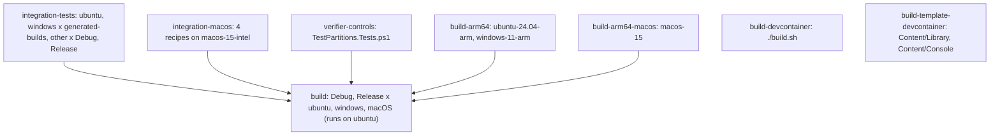

# Build workflow

`.github/workflows/build.yml` runs the integration tests in partitions and then verifies that the partitions cover all tests.
Each test job installs SDKs 10.x and 11.x.
SDK 11 builds every project, because `global.json` pins `11.0.100`.
The 10.x install supplies the .NET 10 runtime for `build/build.fsproj`, `tests/MiniScaffold.Tests`, and the generated `net10.0` projects.



## Jobs

- `integration-tests` runs `./build.sh IntegrationTests` or `./build.cmd IntegrationTests` with `CI: true`, `MINISCAFFOLD_TEST_PARTITION`, and `MINISCAFFOLD_TEST_OS`.
  It uploads `TestResults/partitions/<partition>/` as partition evidence and `TestResults/generated-builds/**` as diagnostics.
  Its build steps set `MSBUILDDEBUGPATH` to `$RUNNER_TEMP/msbuild-debug`, and a failed job uploads that folder as `msbuild-failures-<os>-<configuration>-<partition>-<run_id>-<run_attempt>` (`if-no-files-found: ignore`).
  MSBuild writes `MSBuild_pid-<pid>_<guid>.failure.txt` there when a node fails with an exception that MSBuild handles (`DebugUtils.cs` in dotnet/msbuild). Without `MSBuildDebugEngine`, the variable only sets this folder. Without it, each MSBuild process writes to its own random `MSBuildTemp*` folder, which it deletes at exit (`FileUtilities_TempFiles.cs`), so the files of a worker node are lost. The `MSB4166` message names the folder and points to the variable.
  The generated builds inherit the variable, because `Builds.executeBuild` removes only `MSBuildSDKsPath` and `MSBuildExtensionsPath`. The macOS workload does not set it.
- `integration-macos` runs up to three workloads in sequence through `.github/actions/integration-workload`, with a clean checkout between workloads.
  The action sets `MINISCAFFOLD_TEST_OS: macOS-latest`.
  The four recipes together run each macOS partition once in Debug and once in Release.
- `verifier-controls` runs the verifier self-tests.
- `build-arm64` and `build-arm64-macos` run `./build.sh DotnetPack` and then only the `console archives` tests.
- `build` is the gate. It has `needs` on all jobs above and `if: always()`. Each matrix cell downloads the evidence for one OS and configuration and runs `Verify`.
- `build-devcontainer` runs `./build.sh` in the dev container.
- `build-template-devcontainer` builds the `Content/Library` and `Content/Console` dev containers and runs `dotnet --info` and `starship --version` in each. Starship comes from the official install script, and the job checks that it is `/usr/local/bin/starship` (see [action-versions.md](action-versions.md#starship-in-the-devcontainers)).

## Gate command

Copied from `.github/workflows/build.yml`:

```bash
./build/TestPartitions.ps1 -Mode Verify -Configuration $env:TEST_CONFIGURATION -OperatingSystem $env:TEST_OS -RunId $env:GITHUB_RUN_ID -RunAttempt $env:GITHUB_RUN_ATTEMPT -SourceRevision $env:GITHUB_SHA -BundleRoot $env:PARTITION_BUNDLES -WorkersResult $env:WORKERS_RESULT
```

`WORKERS_RESULT` is `success` only when all five worker jobs succeed.
After `Verify`, `dorny/test-reporter@v3` reports `**/outer/outer.trx` in the job summary.
See [action-versions.md](action-versions.md) for the action versions and the artifact contracts.

## Invariants

- A change to the partition plan must change `build/build.fs`, `build/TestPartitions.ps1`, `build.yml`, and `build/TestPartitions.Tests.ps1` together.
- Evidence artifact names include `run_id` and `run_attempt`. A failed partition needs "Re-run all jobs", because `Verify` requires bundles from one run attempt.
- `publish.yml` and `fsdocs-gh-pages.yml` install the SDK from `global.json` plus `10.x`, the runtime of `build/build.fsproj`.

## Related

- [summary.md](summary.md)
- [action-versions.md](action-versions.md)
- [../tests/test-partitions.md](../tests/test-partitions.md)
- [../tests/process-capture.md](../tests/process-capture.md) - the source of `TestResults/generated-builds/**`.
