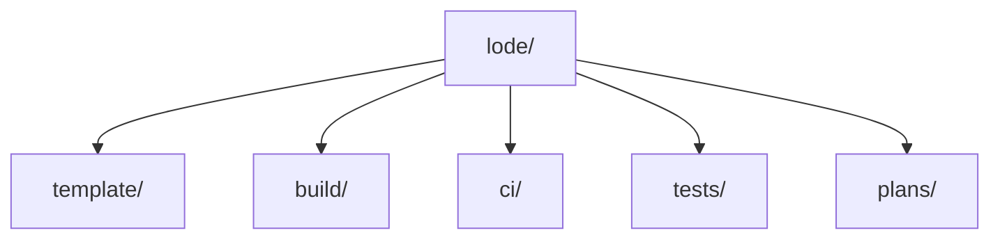

# Lode map



Session start (from the Lode Coding prompt in `AGENTS.md`):

```text
read lode/lode-map.md, lode/terminology.md, lode/summary.md
```

## Root

- [summary.md](summary.md) - system snapshot and domain links.
- [terminology.md](terminology.md) - domain terms.
- [practices.md](practices.md) - conventions and gotchas.

## template/ (`Content/`)

- [template/summary.md](template/summary.md)
- [template/template-configuration.md](template/template-configuration.md)
- [template/library-output.md](template/library-output.md)
- [template/console-output.md](template/console-output.md)
- [template/project-outputs.md](template/project-outputs.md)

## build/ (`build/`, root MSBuild files, `MiniScaffold.csproj`, `docsSrc/`, `tools/`)

- [build/summary.md](build/summary.md)
- [build/fake-targets.md](build/fake-targets.md)
- [build/release-and-publish.md](build/release-and-publish.md)
- [build/template-package.md](build/template-package.md)
- [build/msbuild-infrastructure.md](build/msbuild-infrastructure.md)
- [build/documentation-site.md](build/documentation-site.md)
- [build/release-notes-script.md](build/release-notes-script.md)

## ci/ (`.github/`)

- [ci/summary.md](ci/summary.md)
- [ci/workflows.md](ci/workflows.md)

## tests/ (`tests/`, `build/TestPartitions*.ps1`)

- [tests/summary.md](tests/summary.md)
- [tests/integration-tests.md](tests/integration-tests.md)
- [tests/test-partitions.md](tests/test-partitions.md)
- [tests/process-capture.md](tests/process-capture.md)
- [tests/policy-tests.md](tests/policy-tests.md)

## plans/

- [plans/github-issues.md](plans/github-issues.md) - tickets and plans live in GitHub issues.

## Outside Lode

- [AGENTS.md](../AGENTS.md) - Lode Coding prompt and the GitHub issues rule.
- [README.md](../README.md) - user and maintainer overview.
- [CHANGELOG.md](../CHANGELOG.md) - release history and version source.
- [docsSrc/](../docsSrc/index.md) - human documentation (Divio).
- ADR folder - none exists yet.
- Out of scope: `.vscode/`, `.devcontainer/`, `.config/` (see [build/msbuild-infrastructure.md](build/msbuild-infrastructure.md)), `CODE_OF_CONDUCT.md`, `LICENSE.md`, `.editorconfig`, `.gitattributes`, `.git-blame-ignore-revs`.
