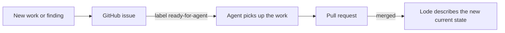

# GitHub issues

Tickets, plans, roadmaps, and TODOs for MiniScaffold live in [GitHub issues](https://github.com/TheAngryByrd/MiniScaffold/issues), not in the Lode.
`AGENTS.md` states this rule. It overrides the `plans/` entry in the Lode Coding prompt.



## Rules

- Write open work as a GitHub issue. Do not write a plan file in `lode/plans/`.
- The label `ready-for-agent` marks an issue that an agent can implement.
- An issue without a label has no decision yet. Do not treat it as accepted work.
- A Lode file can link to an issue when the issue explains a gap in the current state. The Lode does not copy the issue content.
- When a PR closes an issue, update the Lode files for the changed behavior.

## Commands

```bash
gh issue list --state open
gh issue list --label ready-for-agent
gh issue view 321
```

## Related

- [../summary.md](../summary.md)
- [../practices.md](../practices.md)
