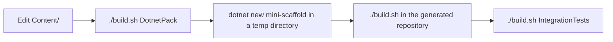

# Practices

`AGENTS.md` holds the agent rules for this repository and the Lode Coding prompt.

## Change loop for template content



Targets from `build/build.fs`:

```bash
./build.sh FormatCode
./build.sh CheckFormatCode
./build.sh
```

## Conventions

- Write tickets and plans as GitHub issues, not as Lode files. See [plans/github-issues.md](plans/github-issues.md).
- Pack the template after each change to `Content/`. The tests install the package from `dist/`, not the source files.
- Keep `CHANGELOG.md` in Keep a Changelog form. The build takes the package version and release notes from it.
- Put each documentation page in the Divio directory that matches the reader need, and link it from that directory's `0-toc.md`.
- Write documentation in Simplified Technical English, as the existing `docsSrc/` pages do.
- Keep `Content/Library/build/Changelog.fs` and the root `build/Changelog.fs` identical. They are identical now.

## Gotchas

- A full local `IntegrationTests` run takes more than an hour. See [tests/summary.md](tests/summary.md). Do not cancel it.
- `.gitignore` ignores every directory named `docs`, `temp`, or `tmp`. Git does not track new files in such a directory.
- `.gitignore` ignores `Content/**/packages.lock.json`, and `MiniScaffold.csproj` excludes them from the package.
- The release and publish tests patch the generated `build/build.fs` by text match. A rename of a build function in `Content/*/build/build.fs` breaks them. See [tests/integration-tests.md](tests/integration-tests.md).
- A new top-level test group under `samples.` breaks the partition coverage proof. See [tests/test-partitions.md](tests/test-partitions.md).
- Publish targets fail outside CI by design. Use the tag workflow. See [build/release-and-publish.md](build/release-and-publish.md).
- `RevertChangelog` and `DeleteChangelogBackupFile` must stay out of the dependency chain (source comment in `build/build.fs`).
- `tools/releaseToChangelog.fsx` uses Paket syntax and reads `RELEASE_NOTES.md`. No build step calls it.

## Related

- [summary.md](summary.md)
- [build/msbuild-infrastructure.md](build/msbuild-infrastructure.md)
