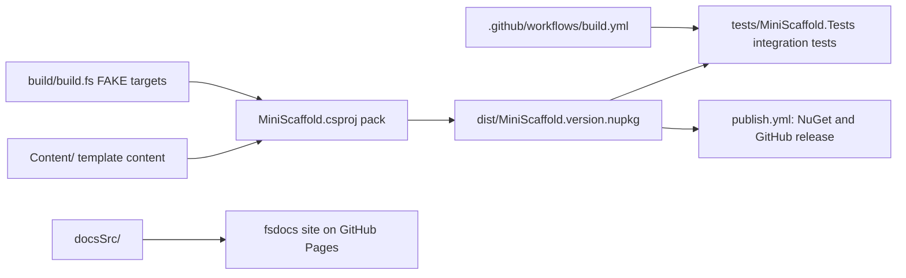

# MiniScaffold summary

MiniScaffold is a `dotnet new` template package (short name `mini-scaffold`) for F# libraries and console applications.
The template content lives under `Content/`, and `MiniScaffold.csproj` packs it into `dist/MiniScaffold.<version>.nupkg`.
A FAKE build in `build/` restores, builds, packs, and releases the package, and runs the integration tests in `tests/MiniScaffold.Tests`.
The integration tests install the packed template, generate repositories, and run the generated builds.
GitHub Actions run the tests in partitions on Linux, Windows, and macOS, and publish the package with NuGet trusted publishing on `v*` tags.



Users install and run the template with these commands (`README.md`):

```bash
dotnet new install "MiniScaffold::*"
dotnet new mini-scaffold -n MyCoolNewLib --githubUsername MyGithubUsername
```

## Domains

- [template/summary.md](template/summary.md) - the template content in `Content/` and its output types.
- [build/summary.md](build/summary.md) - the root FAKE build, packing, release, and documentation build.
- [ci/summary.md](ci/summary.md) - the GitHub Actions workflows of the root repository.
- [tests/summary.md](tests/summary.md) - the integration tests and the test partitions.

See also [terminology.md](terminology.md) and [practices.md](practices.md).
