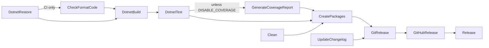

# Console output

`--outputType console` copies `Content/Console/` into a complete console application repository.
`docsSrc/Reference/Console_Output.md` is the human reference for the generated files.
The console output publishes ZIP archives to a GitHub release. It does not publish NuGet packages.

## Layout

The layout matches the [library output](library-output.md), with these differences:

- `src/MyLib.1/` targets net10.0 and uses Argu for argument parsing.
- There is no `docsSrc/`, `build/FsDocs.fs`, `.fantomasignore`, or `publish.yml`.
- The only workflow is `.github/workflows/build.yml`, with `paths-ignore` for `*.md`.

## FAKE target graph

The default target is `CreatePackages` (`Content/Console/build/build.fs`).



## Archives

`CreatePackages` runs `dotnet publish -c Release --runtime <rid> --self-contained false /p:UseAppHost=true` for each runtime.
It writes `dist/{product}-{version}-{rid}.zip` and sets Unix mode 0755 on the app host.

```fsharp
let runtimes = [
    "linux-x64"
    "osx-x64"
    "win-x64"
    "linux-arm64"
    "osx-arm64"
    "win-arm64"
]
```

Source: `Content/Console/build/build.fs`.
The archives are framework-dependent, so the destination computer needs the .NET runtime (`README.md`).

## Release contract

- `Release` runs locally. `GitHubRelease` needs `GITHUB_TOKEN` and runs the branch check, not a tag check.
- `GitHubRelease` uploads the zip, tgz, and tar.gz files from `dist/`.
- `isRelease` looks for the `Release` target. The library output looks for `PublishToNuGet`.
- Coverage is on by default. Set `DISABLE_COVERAGE` to turn it off.

## Differences from the library build

- `Content/Console/build/Changelog.fs` uses `isChangelogEmpty` where the library uses `failOnEmptyChangelog`.
- The console `Changelog.fs` formats tags as `"%s"` (no `v`), but `build.fs` pushes git tags with a `v` prefix.
- `Content/Library/build/Changelog.fs` and the root `build/Changelog.fs` are identical.

## Related

- [template-configuration.md](template-configuration.md)
- [../tests/integration-tests.md](../tests/integration-tests.md) - the `console archives` tests check the ZIP contents.
