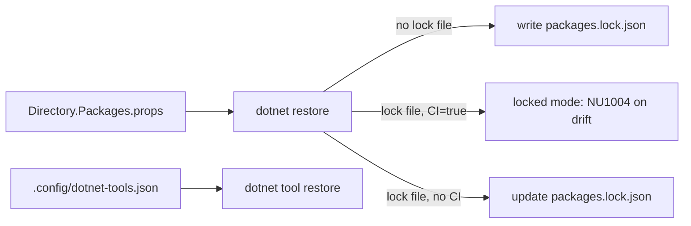

# Template dependencies

This file lists the package and .NET tool versions of the template content and of the root build, and the restore rules that apply to them.
Each `Directory.Packages.props` uses central package management, so a `.fsproj` names a package without a version.



## Package versions

| Package | Root | Library | Console |
| --- | --- | --- | --- |
| FSharp.Core | 11.0.101 | 10.0.102 | 10.0.102 |
| Expecto | 11.1.1 | 11.1.1 | 11.1.1 |
| YoloDev.Expecto.TestSdk | 0.16.1 | 0.16.1 | 0.16.1 |
| Microsoft.NET.Test.Sdk | 18.12.0 | 18.12.0 | 18.12.0 |
| altcover | - | 9.0.189 | 9.0.189 |
| Argu | 6.2.5 | - | 6.2.5 |
| MSBuild.StructuredLogger | 2.3.269 | 2.3.269 | 2.3.269 |
| FSharp.Analyzers.Build | - | 0.5.0 | 0.5.0 |
| Ionide.Analyzers | - | 0.22.0 | 0.22.0 |
| G-Research.FSharp.Analyzers | - | 0.28.0 | 0.28.0 |
| FAKE packages (`FakeVersion`) | 6.2.0 | 6.2.0 | 6.2.0 |

- The content FSharp.Core stays at `10.0.102`. It is the FSharp.Core dependency of each packed generated library, so consumers do not need a newer FSharp.Core. The highest FSharp.Core floor of a package in the table is `8.0.400` (FAKE).
- The root projects set `DisableImplicitFSharpCoreReference` and do not pin transitive versions. `build/build.fsproj` and `tests/MiniScaffold.Tests` reference FSharp.Core directly, so the root `11.0.101` entry applies. Without the direct reference, FAKE brings FSharp.Core `8.0.400`.
- The library `Directory.Packages.props` sets `CentralPackageTransitivePinningEnabled`. The console file does not.

## Tool versions

| Tool | Root | Library | Console |
| --- | --- | --- | --- |
| fantomas | 8.1.3 | 8.1.3 | 8.1.3 |
| fsdocs-tool | 22.2.0 | 22.2.0 | - |
| fsharp-analyzers | - | 0.43.0 | 0.43.0 |
| dotnet-reportgenerator-globaltool | - | 5.6.1 | 5.6.1 |

The root tool restore and the format on build are in [../build/msbuild-infrastructure.md](../build/msbuild-infrastructure.md).

## Lock files

Each `Directory.Packages.props` sets `RestorePackagesWithLockFile`. The template package ships no `packages.lock.json` (`MiniScaffold.csproj` excludes them), so the first restore of a generated repository writes one for `src`, `tests`, and `build`.

The library sets locked mode only on CI:

```xml
<RestorePackagesWithLockFile>true</RestorePackagesWithLockFile>
<RestoreLockedMode Condition="'$(CI)' == 'true'">true</RestoreLockedMode>
```

- Without a lock file, a locked-mode restore writes the lock file and succeeds. NuGet behaves this way on SDK `11.0.100`. The NuGet documentation does not state it.
- With `CI=true`, a restore fails with `NU1004` when a lock file does not match the project dependencies.
- Without `CI`, a restore updates the lock file. A developer commits the updated lock file with the version change.
- The console output and the root set `RestorePackagesWithLockFile` without `RestoreLockedMode`.
- `AuditPolicyTests.fs` restores generated projects with `--force` and `-p:RestoreLockedMode=false`.
- The contract test "library restore creates lock files and locks them only in CI" checks these rules. See [../tests/integration-tests.md](../tests/integration-tests.md).

## SourceLink

The .NET SDK adds SourceLink for GitHub, so the template references no `Microsoft.SourceLink.GitHub` package.
`src/Directory.Build.props` sets `EnableSourceLink=false` and `IncludeSourceRevisionInInformationalVersion=false` for Debug builds ([PR #306](https://github.com/TheAngryByrd/MiniScaffold/pull/306)).
A Release pack writes the SourceLink JSON into each PDB, and the nuspec `repository` element has the commit. A Debug pack writes no SourceLink JSON.

## AltCover

AltCover 9 writes one `$(TEMP)/tmp*.altcover.runsettings` file for each test run and deletes only that file (`AltCoverDeleteTempRunSettingsFile` in `build/AltCover.proj` of the package).
The test runs of the two library TFMs can run in parallel with coverage, so `tests/Directory.Build.props` does not change `TestTfmsInParallel`.

## Analyzers

FSharp.Analyzers.Build runs the `fsharp-analyzers` tool after each `src` build (see [library-output.md](library-output.md)).
The tool loads the Ionide and G-Research analyzers (27 analyzers from 2 assemblies).
The template code gets one hint, `IONIDE-012` ("Consider adding [<Struct>] to Discriminated Union"). A hint does not fail the build.

## Related

- [library-output.md](library-output.md)
- [console-output.md](console-output.md)
- [../build/template-package.md](../build/template-package.md)
