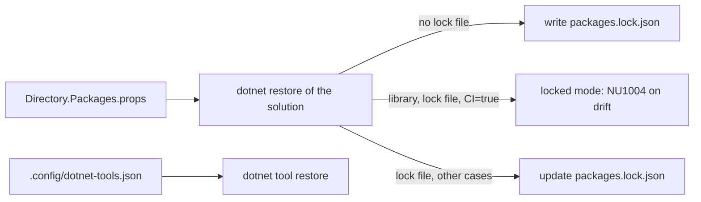

# Template dependencies

This file lists the package and .NET tool versions of the template content and of the root build, and the restore rules that apply to them.
Each `Directory.Packages.props` uses central package management, so a `.fsproj` names a package without a version.



## Package versions

| Package | Root | Library | Console |
| --- | --- | --- | --- |
| FSharp.Core | 11.0.101 | 10.0.102 | 10.0.102 |
| Expecto | 11.1.1 | 11.1.1 | 11.1.1 |
| YoloDev.Expecto.TestSdk | 0.16.1 | 0.16.1 | 0.16.1 |
| Microsoft.NET.Test.Sdk | 18.12.0 | 18.12.0 | 18.12.0 |
| altcover | - | 9.0.189 | 9.0.189 |
| Argu | 6.2.5 | - | 6.2.5 |
| MSBuild.StructuredLogger | 2.3.269 | 2.3.269 | 2.3.269 |
| FSharp.Analyzers.Build | - | 0.5.0 | 0.5.0 |
| Ionide.Analyzers | - | 0.22.0 | 0.22.0 |
| G-Research.FSharp.Analyzers | - | 0.28.0 | 0.28.0 |
| FAKE packages (`FakeVersion`) | 6.2.0 | 6.2.0 | 6.2.0 |

- The content FSharp.Core stays at `10.0.102`. It is the FSharp.Core dependency of each packed generated library, so consumers do not need a newer FSharp.Core. The highest FSharp.Core floor of a package in the table is `8.0.400` (FAKE).
- The root projects set `DisableImplicitFSharpCoreReference` and do not pin transitive versions. `build/build.fsproj` and `tests/MiniScaffold.Tests` reference FSharp.Core directly, so the root `11.0.101` entry applies. Without the direct reference, FAKE brings FSharp.Core `8.0.400`. The root sets `DisableImplicitLibraryPacksFolder=true`, so restore takes FSharp.Core only from nuget.org (see [../build/msbuild-infrastructure.md](../build/msbuild-infrastructure.md)). The template content does not need it: the SDK folder holds FSharp.Core 11.0.101 only, and the content uses 10.0.102.
- The library `Directory.Packages.props` sets `CentralPackageTransitivePinningEnabled`, so each library project, `build/build.fsproj` included, resolves FSharp.Core `10.0.102`.
- The console file does not pin transitive versions. The console `build/build.fsproj` has no FSharp.Core reference, so FAKE brings FSharp.Core `8.0.400` there.

## Tool versions

| Tool | Root | Library | Console |
| --- | --- | --- | --- |
| fantomas | 8.1.3 | 8.1.3 | 8.1.3 |
| fsdocs-tool | 22.2.0 | 22.2.0 | - |
| fsharp-analyzers | - | 0.43.0 | 0.43.0 |
| dotnet-reportgenerator-globaltool | - | 5.6.1 | 5.6.1 |

The root tool restore and the format on build are in [../build/msbuild-infrastructure.md](../build/msbuild-infrastructure.md).

## Lock files

Each `Directory.Packages.props` sets `RestorePackagesWithLockFile`. The template package ships no `packages.lock.json` (`MiniScaffold.csproj` excludes them), so the first solution restore of a generated repository writes one for `src`, `tests`, and `build`. A restore of one project writes the lock files of that project and of the projects it references.

The library sets locked mode only on CI:

```xml
<RestorePackagesWithLockFile>true</RestorePackagesWithLockFile>
<RestoreLockedMode Condition="'$(CI)' == 'true'">true</RestoreLockedMode>
```

- Without a lock file, a locked-mode restore writes the lock file and succeeds. NuGet behaves this way on SDK `11.0.100`. The NuGet documentation does not state it.
- With `CI=true`, a restore fails with `NU1004` when a lock file does not match the project dependencies. MSBuild compares the value without case, so `True` also locks.
- With another `CI` value (`false`, `1`) or no `CI`, a restore updates the lock file. A developer commits the updated lock file with the version change.
- The condition is the same as the CI condition of the NuGet audit rule in `Directory.Build.props`. The generated `build.yml` sets `CI: true` for its build steps, and GitHub Actions sets `CI=true` on each runner. The generated devcontainer job does not set `CI`, so it restores without locked mode.
- The console output and the root set `RestorePackagesWithLockFile` without `RestoreLockedMode`.
- `AuditPolicyTests.fs` restores generated projects with `--force` and `-p:RestoreLockedMode=false`.
- The contract test "library restore creates lock files and locks them only in CI" checks these rules. See [../tests/integration-tests.md](../tests/integration-tests.md).

## SourceLink

The .NET SDK adds SourceLink for GitHub, so the template references no `Microsoft.SourceLink.GitHub` package.
`src/Directory.Build.props` sets `EnableSourceLink=false` and `IncludeSourceRevisionInInformationalVersion=false` for Debug builds ([PR #306](https://github.com/TheAngryByrd/MiniScaffold/pull/306)).
A Release pack writes the SourceLink JSON into each PDB, and the nuspec `repository` element has the commit. A Debug pack writes no SourceLink JSON.

## AltCover

AltCover 9 writes one `$(TEMP)/tmp*.altcover.runsettings` file for each test run and deletes only that file (`AltCoverDeleteTempRunSettingsFile` in `build/AltCover.proj` of the package).
The test runs of the two library TFMs can run in parallel with coverage, so `tests/Directory.Build.props` does not change `TestTfmsInParallel`.
Since AltCover 9, the default is deferred recording at unload or exit time, and one visit for each context (`--all` and `--eager` restore the old counts). Coverage percentages do not change, but visit counts can be lower than AltCover 8 counts.
The `MyCoolLib` generated build case runs `DotnetTest` with `CI=true` and `ENABLE_COVERAGE=true` in a committed git repository, and requires visited sequence points in the `MyCoolLib` module of `coverage.net10.0.xml` and `coverage.net11.0.xml`. A single run does not prove that the old race is gone, so the evidence for that is the AltCover source. Generated libraries run coverage in the Debug leg of their `build.yml` (see [Coverage with ContinuousIntegrationBuild](#coverage-with-continuousintegrationbuild)). The console build has coverage on unless `DISABLE_COVERAGE` has a true value (`1`, `y`, `yes`, `t`, or `true`).

## Coverage with ContinuousIntegrationBuild

`src/Directory.Build.props` sets `ContinuousIntegrationBuild` when `CI` is `true`. When the project has a source root (git provides one), the F# SDK then maps the PDB source paths to `/_/` (`DeterministicSourcePaths`, `_SetPathMapFromSourceRoots` in `Microsoft.FSharp.NetSdk.targets`). `dotnetTest` passes `/p:AltCoverLocalSource=true`, which skips an assembly whose first source path does not exist, so AltCover would skip every project assembly and fail the threshold with 0 of 0 points. `AltCoverLocalSource` stays, because FSharp.Core, the test platform, and AltCover.Monitor embed PDBs whose sources are not local.

For a coverage run on CI, `dotnetBuild` passes `/p:UseLocalSourcePaths=true` (`isCI.Value && coverageEnabled ctx` in the library build, `isCI.Value && not disableCodeCoverage` in the console build). Only `src/Directory.Build.props` reads it:

```xml
<DeterministicSourcePaths Condition="'$(UseLocalSourcePaths)' == 'true'">false</DeterministicSourcePaths>

<CoreCompileCache Include="ContinuousIntegrationBuild=$(ContinuousIntegrationBuild);DeterministicSourcePaths=$(DeterministicSourcePaths)" />
```

F# sets `PathMap` after `_GenerateCompileDependencyCache` hashes the compile inputs, so a change of the mapping alone does not compile again. The `CoreCompileCache` item puts the mapping mode into that hash, so a `src` project compiles again when the mode changes in either direction. The build project is not under `src`, so it does not compile again (a forced rebuild would try to overwrite the running `build.exe`). The library `DotnetPack` after a coverage build compiles again with the mapped paths.

The generated library `build.yml` sets `ENABLE_COVERAGE: ${{ matrix.configuration == 'Debug' }}`, because Release optimizations lower the measured coverage below the 80% threshold (2 of 3 points in a new library). The shipped binaries come from builds without `UseLocalSourcePaths`. The library `publish.yml` sets `ENABLE_COVERAGE: false`. The console `CreatePackages` target runs the tests with coverage, then publishes each RID with `dotnet publish -c Release`, which compiles again with mapped paths. A coverage build leaves the local checkout path in the PDBs under `bin` and `obj` and in the `File/@fullPath` values of the coverage XML. The generated workflows upload neither.

The integration tests generate repositories without git, so their CI builds keep local paths. The `MyCoolLib` and `MyCoolApp` cases commit the repository before their coverage check (`Effect.``commit the repository```). See [../tests/integration-tests.md](../tests/integration-tests.md).

## Analyzers

FSharp.Analyzers.Build runs the `fsharp-analyzers` tool after each `src` build that compiles (see [library-output.md](library-output.md)). It passes the compiler arguments in `obj/<configuration>/<tfm>/fsc-analyzers.rsp` with `--fsc-args-file`. When `CoreCompile` skips, the analyzers do not run unless `FSharpAnalyzersAlwaysRunAfterBuild` is `true`.
The tool loads the Ionide and G-Research analyzers (27 analyzers from 2 assemblies).
The library and console code gets one hint, `IONIDE-012` ("Consider adding [<Struct>] to Discriminated Union"). A hint does not fail the build.
`Content/ProjConsole/Program.fs` calls `System.Console.WriteLine`, because `printfn` with no format specifier gets `IONIDE-014`.

## Related

- [library-output.md](library-output.md)
- [console-output.md](console-output.md)
- [../build/template-package.md](../build/template-package.md)
