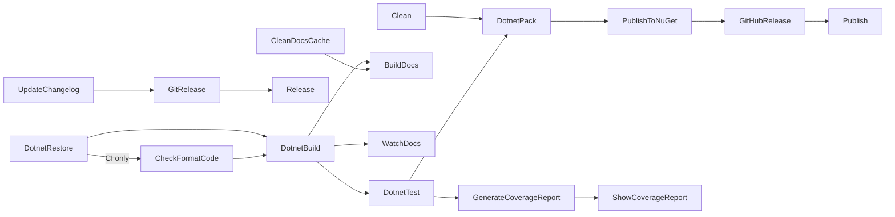

# Library output

`--outputType library` (the default) copies `Content/Library/` into a complete library repository.
`docsSrc/Reference/Library_Output.md` is the human reference for the generated files.

## Layout

- `src/MyLib.1/` - the library. Targets net8.0, net9.0, and net10.0.
- `tests/MyLib.1.Tests/` - Expecto tests on net10.0, with AltCover coverage.
- `build/` - `build.fs`, `Changelog.fs`, `FsDocs.fs`, and `build.fsproj` (net8.0).
- `docsSrc/` - fsdocs source for the generated documentation site.
- `.github/workflows/` - `build.yml`, `publish.yml`, and `fsdocs-gh-pages.yml`.
- `MyLib.1.slnx`, `Directory.Packages.props` (central package management), and `global.json` (SDK `10.0.100`).

## FAKE target graph

`Content/Library/build/build.fs` declares these chains. The default target is `DotnetPack`.

```fsharp
"DotnetRestore"
=?> ("CheckFormatCode", isCI.Value)
==> "DotnetBuild"
==> "DotnetTest"
==> "DotnetPack"
==> "PublishToNuGet"
==> "GitHubRelease"
==>! "Publish"
```



`SourceLinkTest`, `FormatCode`, `RevertChangelog`, and `DeleteChangelogBackupFile` are outside these chains.
The source states: `// Do NOT put this in the dependency chain` for `RevertChangelog` and `DeleteChangelogBackupFile`.

## Release contract

1. A maintainer runs `./build.sh Release 0.2.0` locally (`Content/Library/README.md`).
2. `UpdateChangelog` moves `Unreleased` items into a new entry. `GitRelease` checks the branch, commits "Bump version to X", and pushes tag `v{version}`.
3. `publish.yml` runs on `v*` tags in the `nuget` environment with `id-token: write`.
4. `NuGet/login@v1` exchanges the OIDC token for a short-lived key that the job passes as `NUGET_TOKEN`.
5. `./build.sh Publish` runs `PublishToNuGet` and `GitHubRelease`.

`allPublishChecks` guards both publish targets: CI only, a non-empty changelog, and `RELEASE_TAG` equal to `v{NuGetVersion}` (ordinal compare).
The same contract as the root build applies. See [../build/release-and-publish.md](../build/release-and-publish.md).

## Build settings

- Fantomas runs on each build through `Directory.Build.targets`. Set `FormatOnBuild=false` to skip it.
- `src/Directory.Build.props` enables `TreatWarningsAsErrors` and `Nullable`, and adds the Ionide and G-Research analyzers with `GeneratePathProperty="true"`.
- FSharp.Analyzers.Build runs the analyzers after each build with the `$(PkgIonide_Analyzers)` and `$(PkgG-Research_FSharp_Analyzers)` paths (`src/Directory.Build.targets`). Analyzer findings do not fail the build.
- `GenerateCoverageReport` writes the HTML report to `docs/coverage`. `Content/Library/docsSrc/index.md` has no link to it ([issue #226](https://github.com/TheAngryByrd/MiniScaffold/issues/226)).
- Coverage is opt-in through `ENABLE_COVERAGE`. The `publish.yml` comment states: "AltCover doesn't work with Release builds".
- `Directory.Packages.props` sets `RestorePackagesWithLockFile` and `RestoreLockedMode`. The template ships no `packages.lock.json`, so the first restore creates it.
- The generated `build.yml` runs Debug and Release on ubuntu, windows, and macOS, plus a devcontainer job.
- `fsdocs-gh-pages.yml` runs `./build.sh builddocs` and deploys `docs/` to GitHub Pages.

## Related

- [template-configuration.md](template-configuration.md)
- [console-output.md](console-output.md)
- [../tests/policy-tests.md](../tests/policy-tests.md) - GeneratedReleasePolicy and TrustedPublishing tests check this output.
