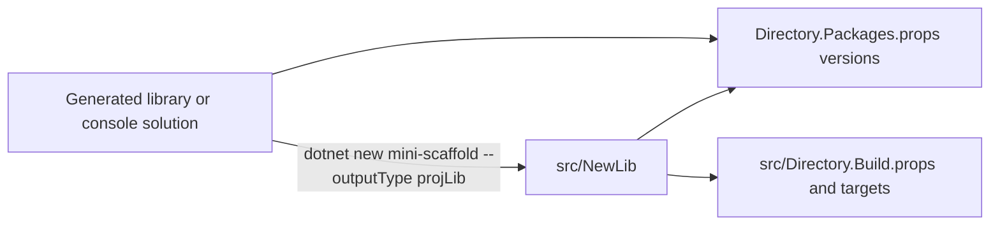

# Project outputs

`--outputType projLib`, `projConsole`, and `projTest` generate one project for an existing MiniScaffold solution.
Each output contains only an `.fsproj` and its source files. It has no solution, build scripts, or MSBuild props.

| Output type | Source directory | Files |
| --- | --- | --- |
| `projLib` | `Content/ProjLib/` | `MyLib.1.fsproj`, `Library.fs` |
| `projConsole` | `Content/ProjConsole/` | `MyLib.1.fsproj`, `Program.fs` |
| `projTest` | `Content/ProjTest/` | `MyLib.1.fsproj`, `Main.fs`, `Tests.fs` |

## Contract with the host solution

- Each `.fsproj` omits package versions, so the host solution must use central package management.
- `ProjLib` targets net8.0, net9.0, and net10.0 and has no FSharp.Core reference. It relies on the host `src/Directory.Build.targets`.
- `ProjTest` has no `ProjectReference`. The user adds the reference.



The how-to guides give the steps. Example (`docsSrc/How_Tos/add-a-library-project.md`):

```bash
dotnet new mini-scaffold -n MyNewLibrary --outputType projLib
dotnet sln add src/MyNewLibrary/MyNewLibrary.fsproj
```

## Tests

The `PackageDocuments` tests pack a `projLib` project inside library and console hosts.
They check that the package has README.md and LICENSE.md, and one DLL for each of net8.0, net9.0, and net10.0.
See [../tests/policy-tests.md](../tests/policy-tests.md).

## Related

- [template-configuration.md](template-configuration.md)
- [library-output.md](library-output.md)
