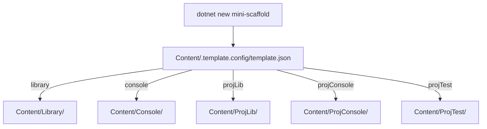

# Template domain

The template domain is the content under `Content/`.
The `dotnet new` template engine copies one source directory and replaces placeholder tokens.
`Content/.template.config/template.json` selects the source directory from the `outputType` parameter.



Example (`docsSrc/Reference/Template_Parameters.md`):

```bash
dotnet new mini-scaffold -n MyCoolNewApp --githubUsername MyGithubUsername --outputType console
```

## Topics

- [template-configuration.md](template-configuration.md) - parameters, sources, placeholder tokens, and the post action.
- [library-output.md](library-output.md) - the generated library repository.
- [console-output.md](console-output.md) - the generated console repository.
- [project-outputs.md](project-outputs.md) - the single-project outputs for an existing solution.

## Related

- [../build/template-package.md](../build/template-package.md) - how `MiniScaffold.csproj` packs `Content/`.
- [../tests/integration-tests.md](../tests/integration-tests.md) - how the tests generate and build each output.
