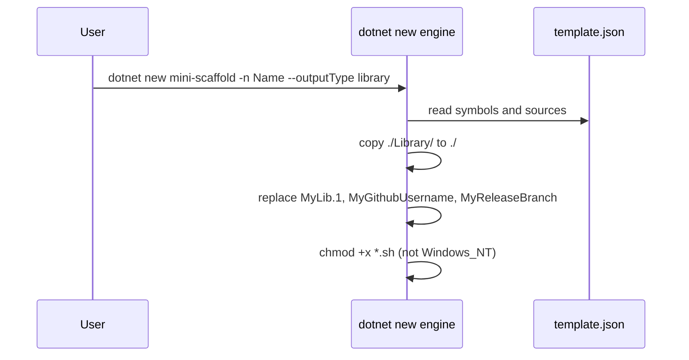

# Template configuration

`Content/.template.config/template.json` defines the template identity, the parameters, the source directories, and the post action.
`Content/.template.config/ide.host.json` makes all three parameters visible in IDEs, with the labels "GitHub Username", "Output Type", and "Release Branch".

## Identity

| Field | Value |
| --- | --- |
| `identity` | `MiniScaffold` |
| `shortName` | `mini-scaffold` |
| `sourceName` | `MyLib.1` |
| `preferNameDirectory` | `true` |

## Parameters and placeholder tokens

| Parameter | Token that it replaces | Default |
| --- | --- | --- |
| `-n` / `--name` (`sourceName`) | `MyLib.1` in file names, directory names, and text | Output directory name |
| `--githubUsername` | `MyGithubUsername` | None |
| `--releaseBranch` | `MyReleaseBranch` | `main` |
| `--outputType` | Selects a source directory | `library` |

`MyLib.1` occurs in `MyLib.1.slnx`, `src/MyLib.1/`, `tests/MyLib.1.Tests/`, `Proj*/MyLib.1.fsproj`, and `build/build.fs`.
The F# namespace form `MyLib._1` occurs in `Content/ProjLib/Library.fs`, `Content/ProjTest/*.fs`, and `Content/Console/src/MyLib.1/Main.fs`.
`MyReleaseBranch` occurs in each generated `build/build.fs` and in the `branches` filters of the generated workflows.

## Sources

Each `outputType` choice maps one directory to the output root (`template.json`):

```json
{
    "source": "./Console/",
    "target": "./",
    "condition": "(outputType == \"console\")"
}
```

The file has no `modifiers`, `exclude`, or `rename` entries.

## Post action

On an OS other than Windows, the template engine runs a chmod post action with args `{"+x": "*.sh"}` and `continueOnError: true`.
If the action fails, the manual instruction is `Run 'chmod +x *.sh'`.
`README.md` records the history under "Known issues": `dotnet new` loses file permissions.



## Invariants

- A new token must have a symbol in `template.json`, or the engine copies the token as text.
- A new output type needs a `choices` entry, a `sources` entry, and an `ide.host.json` entry.
- `docsSrc/Reference/Template_Parameters.md` describes these parameters and must stay in step with `template.json`.

## Related

- [summary.md](summary.md)
- [library-output.md](library-output.md)
- [console-output.md](console-output.md)
- [project-outputs.md](project-outputs.md)
