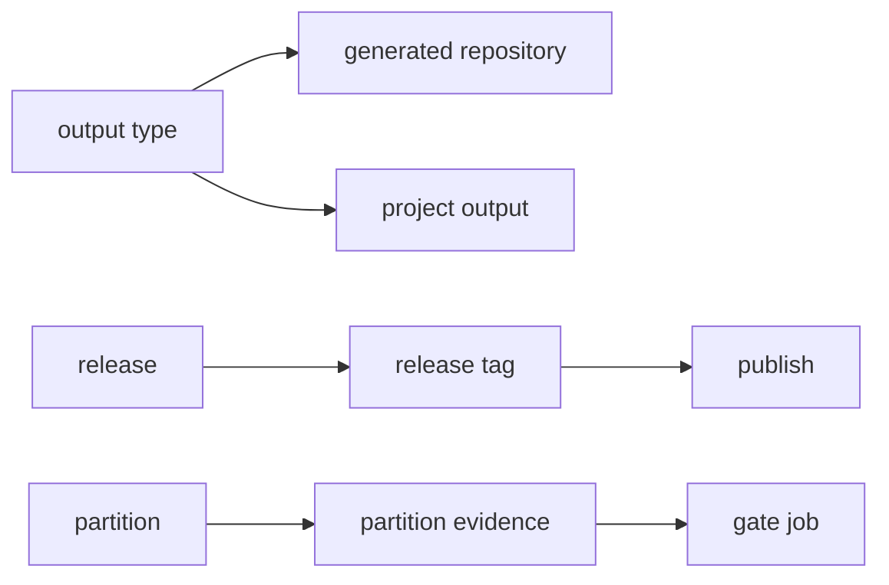

# Terminology

- MiniScaffold - the `dotnet new` template package and this repository.
- template content - the files under `Content/` that the template engine copies.
- output type - the value of `--outputType`: `library`, `console`, `projLib`, `projConsole`, or `projTest`.
- generated repository - the repository that the `library` or `console` output type creates.
- project output - the single project that `projLib`, `projConsole`, or `projTest` creates for an existing solution.
- placeholder token - text in the template content that a parameter replaces: `MyLib.1`, `MyGithubUsername`, `MyReleaseBranch`.
- source name - `MyLib.1`, the token that `-n` replaces in file names, directory names, and text.
- custom hive - the temporary `dotnet new` template store that the tests pass with `--debug:custom-hive`.
- target - a FAKE build target in `build/build.fs`, for example `DotnetPack`.
- release - the local `Release` target: update `CHANGELOG.md`, commit, and push a `v<version>` tag.
- publish - the CI `Publish` target: push the package to NuGet and create the GitHub release.
- release tag - the git tag `v<NuGetVersion>`. `RELEASE_TAG` must equal it.
- trusted publishing - NuGet OIDC login through `NuGet/login@v1` with a short-lived key and no stored key.
- partition - a named subset of the integration tests, selected with `MINISCAFFOLD_TEST_PARTITION`.
- partition evidence - the bundle under `TestResults/partitions/<token>/` with `manifest.json`.
- gate job - the `build` job in `build.yml` that runs `TestPartitions.ps1 -Mode Verify`.
- drain timeout - the time `ProcessCapture` waits for output streams to close after the direct child exits.
- format on build - the `Format` MSBuild target that runs Fantomas on each `.fsproj` build.
- `ready-for-agent` - the GitHub issue label for work that an agent can implement.
- Divio system - the split of `docsSrc/` into `Tutorials`, `How_Tos`, `Reference`, and `Explanations`.



Example of the placeholder tokens (`Content/.template.config/template.json`):

```json
"githubUsername": {
    "type": "parameter",
    "replaces": "MyGithubUsername"
}
```

Related: [summary.md](summary.md), [template/template-configuration.md](template/template-configuration.md).
