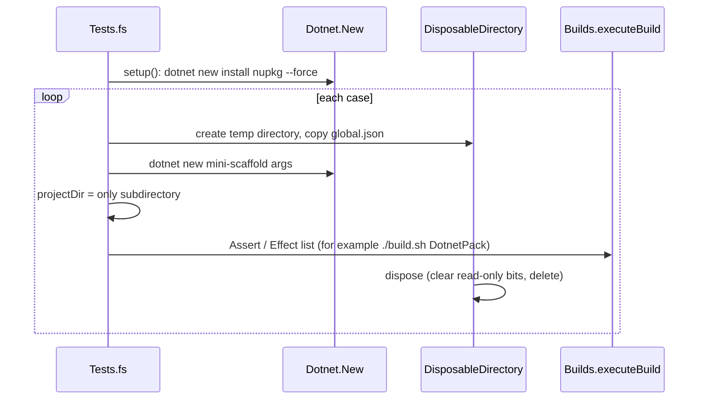

# Integration tests

The `samples` tests in `tests/MiniScaffold.Tests/Tests.fs` install the packed template, generate a repository, and run assertions and effects against it.



## Package location

`nugetPkgPath` uses `MINISCAFFOLD_NUPKG_LOCATION`. If the variable is not set, it uses the first `dist/*.nupkg`.

```fsharp
let nugetPkgPath =
    match Environment.environVarOrNone "MINISCAFFOLD_NUPKG_LOCATION" with
    | Some v ->
        printfn "using MINISCAFFOLD_NUPKG_LOCATION"
        v
    | None ->
        let dist =
            IO.Path.Combine(__SOURCE_DIRECTORY__, "../../dist")
            |> IO.DirectoryInfo

        dist.EnumerateFiles("*.nupkg")
        |> Seq.head
        |> fun fi -> fi.FullName
```

If `dist/` has no package and the variable is not set, `Seq.head` throws.

## Template hive

Each `dotnet new` call gets `--debug:custom-hive <temp>` (`Infrastructure.fs` `Dotnet.New`).
The hive is lazy and the test process deletes it on `ProcessExit`. The tests do not change the user's installed templates.

## Generated builds

`Assert.``project can build target``` calls `Builds.executeBuild`, which runs `bash ./build.sh <target>` or `cmd.exe /c .\build.cmd <target>`.
Before the run, it removes `MSBuildSDKsPath` and `MSBuildExtensionsPath` and sets `MSBUILDDISABLENODEREUSE=1`.
`build target with failure expected` passes only when the build fails.

## Groups

- Library cases alternate between `Library.A` and `Library.B` by index. Console cases go into `Console`.
- These group names are part of the partition plan. See [test-partitions.md](test-partitions.md).

## Release and publish cases

- `setup for release tests` and `setup for publish tests` (`Asserts.fs`) run `git init` and patch the generated `build/build.fs`.
- The patches comment out restore, build, tests, pack, and similar calls, blank the tokens, and turn off the git push.
- Publish cases also set `CI=1` and add `--environment RELEASE_TAG=v0.1.0` to `build.sh` and `build.cmd`.
- `make build function fail` adds a `failwith` to a named function. The tests then check that `CHANGELOG.md` rolls back, unless a step already pushed a release.

## Invariants

- The patches match text such as `let dotnetRestore` in `Content/*/build/build.fs`. A rename of those functions breaks the tests.
- Template installation runs while the `samples` list is built. Other test modules force it through `Tests.tests |> ignore`.
- Most lists use `testSequenced`. CI runs with `Expecto.fail-on-focused-tests=true`, so a focused test fails CI.

## Related

- [summary.md](summary.md)
- [process-capture.md](process-capture.md)
- [../template/summary.md](../template/summary.md)
