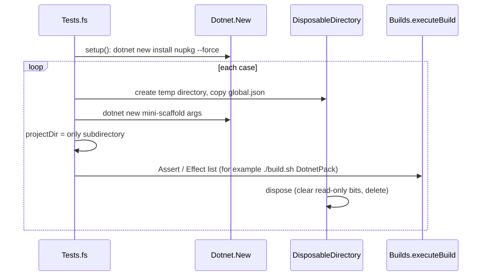
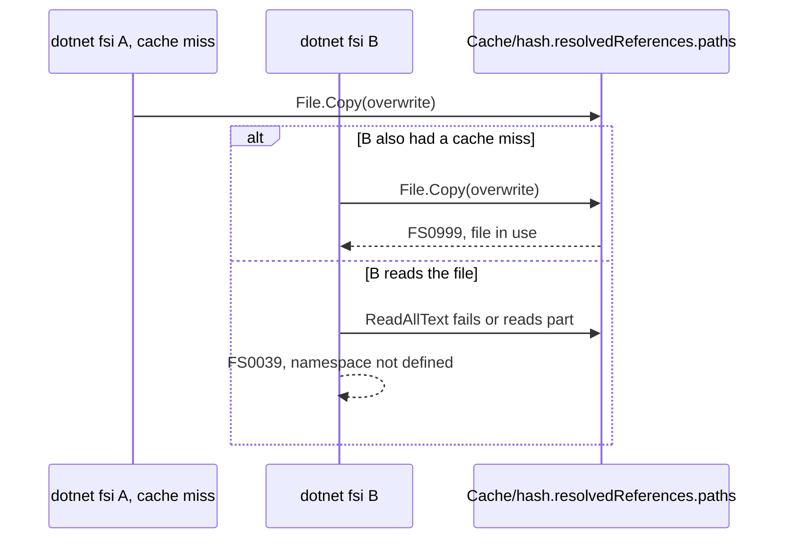

# Integration tests

The `samples` tests in `tests/MiniScaffold.Tests/Tests.fs` install the packed template, generate a repository, and run assertions and effects against it.



## Package location

`nugetPkgPath` uses `MINISCAFFOLD_NUPKG_LOCATION`. If the variable is not set, it uses the first `dist/*.nupkg`.

```fsharp
let nugetPkgPath =
    match Environment.environVarOrNone "MINISCAFFOLD_NUPKG_LOCATION" with
    | Some v ->
        printfn "using MINISCAFFOLD_NUPKG_LOCATION"
        v
    | None ->
        let dist =
            IO.Path.Combine(__SOURCE_DIRECTORY__, "../../dist")
            |> IO.DirectoryInfo

        dist.EnumerateFiles("*.nupkg")
        |> Seq.head
        |> fun fi -> fi.FullName
```

If `dist/` has no package and the variable is not set, `Seq.head` throws.

## Template hive

Each `dotnet new` call gets `--debug:custom-hive <temp>` (`Infrastructure.fs` `Dotnet.New`).
The hive is lazy and the test process deletes it on `ProcessExit`. The tests do not change the user's installed templates.

## Generated builds

`Assert.``project can build target``` calls `Builds.executeBuild`, which runs `bash ./build.sh <target>` or `cmd.exe /c .\build.cmd <target>`.
Before the run, it removes `MSBuildSDKsPath` and `MSBuildExtensionsPath` and sets `MSBUILDDISABLENODEREUSE=1`.
`build target with failure expected` passes only when the build fails.

## Groups

- Library cases alternate between `Library.A` and `Library.B` by index. Console cases go into `Console`.
- These group names are part of the partition plan. See [test-partitions.md](test-partitions.md).

## Target framework cases

- The `MyCoolLib` library case runs `DotnetPack`, then ``tests ran on each target framework`` (`Asserts.fs`). It reads each TRX file in `tests/MyCoolLib.Tests/TestResults`, joins `UnitTestResult/@testId` to `UnitTest/@id`, and takes the TFM from the `UnitTest/@storage` path. Each of `net10.0` and `net11.0` must have a `Passed` result.
- `packed libraries supply FSharp.Core ...` compares the nuspec dependency groups with the literal list `net10.0; net11.0`, and requires one FSharp.Core dependency in each group.
- `library projects share their target frameworks` (`samples.contracts`) runs `dotnet msbuild -getProperty:TargetFrameworks` on the generated library and test projects. Both must give `net10.0;net11.0`, and both must follow `-p:LibraryTargetFrameworks=net11.0`.
- `library restore creates lock files and locks them only in CI` (`samples.contracts`) restores a generated library solution with `CI=true` and no lock files. It then changes the `Expecto` entry in `Directory.Packages.props` to the exact range `[v]` and back to `v`. After each change, a restore with `CI=true` must fail with `NU1004`. A restore with `CI=false` (first change) or without `CI` (second change) must write the new `requested` range for each framework in `tests/<name>.Tests/packages.lock.json`. The restores pass `-p:NuGetAudit=false`, so an advisory cannot fail them. See [../template/dependencies.md](../template/dependencies.md).
- The `MyCoolLib` case runs `BuildDocs`, then ``docs have no unresolved substitutions`` and ``docs use the fsdocs search contract``. Then ``CI workflow collects coverage only in Debug`` requires the Debug-only `ENABLE_COVERAGE` line in the `env` of the `Build via Bash` and `Build via Windows` steps of the generated `build.yml`, and in no other step. The case commits the generated repository with `Effect.``commit the repository```, because the CI source path mapping needs a source root. The effect fails when `GIT_DIR`, `GIT_WORK_TREE`, `GIT_INDEX_FILE`, `GIT_COMMON_DIR`, or `GIT_OBJECT_DIRECTORY` resolves outside the fixture, or when `git rev-parse --show-prefix` is not empty. A relative value, such as `GIT_INDEX_FILE=.git/index.lock` in a git hook, resolves inside the fixture. ``coverage report covers each target framework`` then runs, with `CI=true` and `CONFIGURATION=Debug`: `Clean`, a `DotnetBuild` without coverage whose PDB must start with `/_/`, and `DotnetTest` with `ENABLE_COVERAGE=true` and the threshold after the old reports are deleted. It requires visited points in the `MyCoolLib` module of the coverage XML of each TFM. The library case then deletes the reports and runs `GenerateCoverageReport` with `ENABLE_COVERAGE` unset, because the target turns coverage on by itself. It requires visits again and `docs/coverage/index.html`. The `MyCoolApp` console case commits after `CreatePackages` and runs ``CI coverage report has visits``: `Clean`, the first build with `DISABLE_COVERAGE=true`, and `DotnetTest` with coverage on (`coverage.xml`). Without the `Clean` and the first CI build, an earlier build without `CI` leaves local paths, and the check passes on the old template. See [../template/dependencies.md](../template/dependencies.md#coverage-with-continuousintegrationbuild). See [../build/documentation-site.md](../build/documentation-site.md).
- The audit fixture adds `Argu` (version from `Content/Console/Directory.Packages.props`) to the generated library `src` project, because that project has no transitive package of its own. See [policy-tests.md](policy-tests.md).
- The assertion reads VSTest TRX files. A change of test runner must keep TRX output with `UnitTest/@storage`, or change the assertion.

```fsharp
Assert.``tests ran on each target framework`` "MyCoolLib.Tests" [ "net10.0"; "net11.0" ]
```

## Release and publish cases

- `setup for release tests` and `setup for publish tests` (`Asserts.fs`) run `git init` and patch the generated `build/build.fs`.
- The patches comment out restore, build, tests, pack, and similar calls, blank the tokens, and turn off the git push.
- Publish cases also set `CI=1` and add `--environment RELEASE_TAG=v0.1.0` to `build.sh` and `build.cmd`.
- The `ChangelogTagLinks` cases run `Release` for 0.2.0 in a library and a console repository, and check that the CHANGELOG compare links use `v` tags.
- `make build function fail` adds a `failwith` to a named function. The tests then check that `CHANGELOG.md` rolls back, unless a step already pushed a release.

## Invariants

- The patches match text such as `let dotnetRestore` in `Content/*/build/build.fs`. A rename of those functions breaks the tests.
- Template installation runs while the `samples` list is built. Other test modules force it through `Tests.tests |> ignore`.
- Most lists use `testSequenced`. CI runs with `Expecto.fail-on-focused-tests=true`, so a focused test fails CI.
- Tests that start `dotnet fsi` on a script with `#r "nuget:"` must not run in parallel. Put them in a `testSequenced` list. See [Script package cache](#script-package-cache).

## Script package cache

`dotnet fsi` keeps the package resolution of each `#r "nuget:"` set in `~/.packagemanagement/nuget/Cache/<hash>.resolvedReferences.paths` and `<hash>.fsx`.
The hash covers the script extension, the package lines, the target framework, and the runtime identifier.
On a cache miss, a process restores the packages, writes `<hash>.fsx`, and overwrites the `.paths` file with `File.Copy(..., true)`. On a cache hit, a process only reads them.
A failed read of the `.paths` file gives an empty resolution with no error, and the cache hit then has zero references.

When parallel processes start on a cold cache, they fail in one of two ways:

- A process with a cache miss cannot overwrite the file while another process reads or writes it:

  ```text
  tools/releaseToChangelog.fsx(1,1): error FS0999: The process cannot access the file '/home/runner/.packagemanagement/nuget/Cache/<hash>.resolvedReferences.paths' because it is being used by another process.
  ```

- A process that reads the file during a write gets no references or only part of them. The first `open` of a package namespace fails:

  ```text
  tools/releaseToChangelog.fsx(6,6): error FS0039: The namespace or module 'Fake' is not defined.
  ```



The `release notes to changelog` list in `ReleaseToChangelogTests.fs` runs `tools/releaseToChangelog.fsx` in five tests, so it uses `testSequenced`.
The release policy probes run `dotnet fsi` with `#r @"<path>.dll"` references only. They do not use the package cache.

`testSequenced` orders the tests of one test process only. The cache is per user, so two test runs on one machine can still race on a cold cache.
A process that stops during `File.Copy` can leave an empty or partial `.paths` file. Each later run then fails with FS0039, or with `Internal error - Invalid resolutions file format` when the file ends in the middle of a line.
To recover, delete the cache directory. `dotnet fsi` fills it again on the next run:

```bash
rm -rf ~/.packagemanagement/nuget/Cache
```

## Related

- [summary.md](summary.md)
- [process-capture.md](process-capture.md)
- [../template/summary.md](../template/summary.md)
