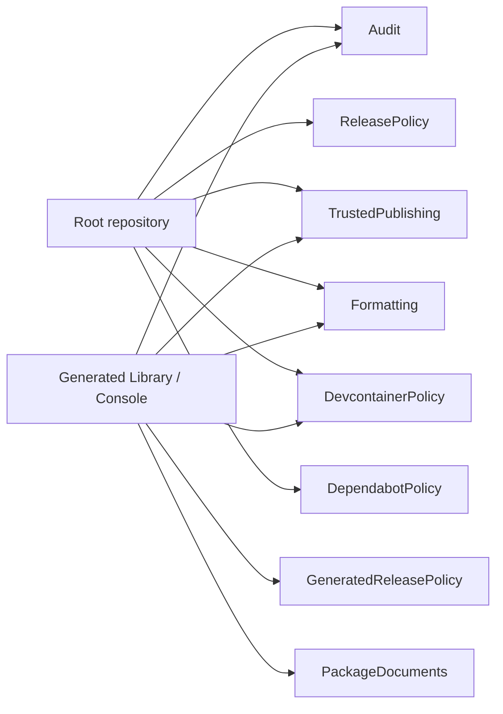

# Policy tests

The policy tests check contracts of the root build and of the generated repositories.
Several tests also run mutation controls that prove each check rejects bad input.



## AuditPolicy (`AuditPolicyTests.fs`)

- Covers the root and build projects, and the library and console source, build, and test projects, each with CI on and off.
- A local advisory feed returns transitive advisories.
- Each scenario needs one transitive package that is neither direct nor centrally managed. The generated library `src` project has none, so the test adds `Argu` to it. `Argu` brings `System.Configuration.ConfigurationManager`.
- NU1903 and NU1904 must be errors only for CI or source projects, and warnings otherwise.
- Required properties: `NuGetAudit=true`, `NuGetAuditMode=all`, `NuGetAuditLevel=low`.

## ReleasePolicy (`ReleasePolicyTests.fs`)

- The test instruments the root `build/build.fs` so that `DotNet.nugetPush` and `GitHub.createClientWithToken` record attempts.
- `PublishToNuGet` and `GitHubRelease` must reject: `CI` unset or false, a missing or wrong tag, an empty changelog, and bad tag forms.
- Bad tag forms include whitespace, `vv`, `V`, `refs/tags/`, a suffix, and a partial version.
- A local release on the wrong branch must fail.
- `publish.yml` must trigger on `v*` and pass `RELEASE_TAG: ${{ github.ref_name }}`.
- The three `Changelog.fs` copies (root, library, console) must be byte-identical.

## GeneratedReleasePolicy (`GeneratedReleasePolicyTests.fs`)

Applies the release contract to a generated library. It also checks `GitRelease` for branch and changelog combinations.
It checks that the generated files equal the template files after parameter substitution.

## TrustedPublishing (`TrustedPublishingTests.fs`)

Checks the root, packed, and generated `publish.yml`:

- The publishing job owns `id-token: write` and `contents: write` and uses the `nuget` environment.
- One `NuGet/login@v<major>` step uses `vars.NUGET_USER` and comes directly before publication. The test accepts any major, so a Dependabot update passes it.
- Publication uses only the login output and keeps the tag guard.
- The READMEs and docs describe the policy with the owner and repository substituted.

## Formatting (`FormattingTests.fs`)

For the root, library, and console builds:

- Format stamps make Fantomas skip unchanged projects.
- Tool restore runs before project dispatch and reuses its stamp.
- A multi-target build formats once. `Clean` removes the stamps.
- `CheckFormatCode` is read-only and reports "Some files need formatting". Parser failures propagate.

## DevcontainerPolicy (`DevcontainerPolicyTests.fs`)

- For the root, `Content/Library`, and `Content/Console`, no non-comment line of `.devcontainer/devcontainer.json` names a starship feature, and `.devcontainer/Dockerfile` has the active line `RUN curl -sS https://starship.rs/install.sh | sh -s -- --yes && starship --version`. See [../ci/action-versions.md](../ci/action-versions.md#starship-in-the-devcontainers).

## DependabotPolicy (`DependabotPolicyTests.fs`)

- For `github-actions`, `devcontainers`, and `nuget`, every tracked manifest (`git ls-files -z`, with a one-minute deadline) must be read by an entry of the `directories` sequence in `.github/dependabot.yml`, by the dependabot-core fetcher rules, and every entry must read a manifest.
- Each `nuget` entry must hold a top-level solution or project file and its own `.config/dotnet-tools.json`.
- The `nuget` block must ignore all FSharp.Core versions and nothing else. Each block must update weekly and have one group with `group-by: dependency-name`.
- `DependabotConfig.fs` parses a Dependabot file into records (`Update`, `Group`, `IgnoreRule`). This policy test and the generated-repository assertion share it.
- The tests read files and run `git ls-files` only. They run in the `other` partition. See [../ci/dependency-updates.md](../ci/dependency-updates.md).

## PackageDocuments (`PackageDocumentTests.fs`)

A `projLib` package in a library or console host must declare README.md and LICENSE.md once each, and contain one DLL for each of net10.0 and net11.0.

Run one group with an Expecto filter, as `.github/workflows/build.yml` does for `console archives`:

```bash
dotnet test tests/MiniScaffold.Tests/MiniScaffold.Tests.fsproj --filter 'FullyQualifiedName~console archives' --logger 'trx;LogFilePrefix=testResults'
```

## Related

- [../build/release-and-publish.md](../build/release-and-publish.md)
- [../build/msbuild-infrastructure.md](../build/msbuild-infrastructure.md)
- [../template/project-outputs.md](../template/project-outputs.md)
