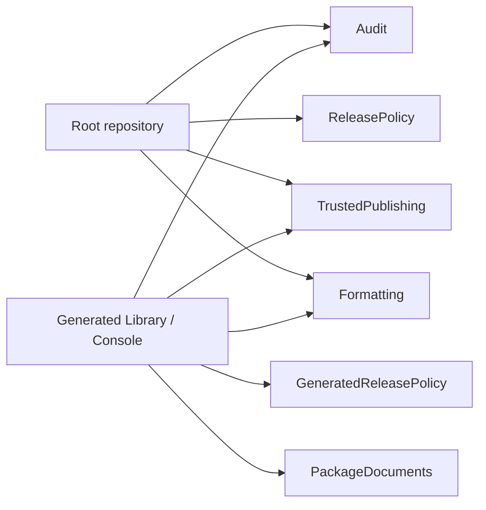

# Policy tests

The policy tests check contracts of the root build and of the generated repositories.
Several tests also run mutation controls that prove each check rejects bad input.



## AuditPolicy (`AuditPolicyTests.fs`)

- Covers the root and build projects, and the library and console source, build, and test projects, each with CI on and off.
- A local advisory feed returns transitive advisories.
- NU1903 and NU1904 must be errors only for CI or source projects, and warnings otherwise.
- Required properties: `NuGetAudit=true`, `NuGetAuditMode=all`, `NuGetAuditLevel=low`.

## ReleasePolicy (`ReleasePolicyTests.fs`)

- The test instruments the root `build/build.fs` so that `DotNet.nugetPush` and `GitHub.createClientWithToken` record attempts.
- `PublishToNuGet` and `GitHubRelease` must reject: `CI` unset or false, a missing or wrong tag, an empty changelog, and bad tag forms.
- Bad tag forms include whitespace, `vv`, `V`, `refs/tags/`, a suffix, and a partial version.
- A local release on the wrong branch must fail.
- `publish.yml` must trigger on `v*` and pass `RELEASE_TAG: ${{ github.ref_name }}`.

## GeneratedReleasePolicy (`GeneratedReleasePolicyTests.fs`)

Applies the release contract to a generated library. It also checks `GitRelease` for branch and changelog combinations.
It checks that the generated files equal the template files after parameter substitution.

## TrustedPublishing (`TrustedPublishingTests.fs`)

Checks the root, packed, and generated `publish.yml`:

- The publishing job owns `id-token: write` and `contents: write` and uses the `nuget` environment.
- One `NuGet/login@v1` step uses `vars.NUGET_USER` and comes directly before publication.
- Publication uses only the login output and keeps the tag guard.
- The READMEs and docs describe the policy with the owner and repository substituted.

## Formatting (`FormattingTests.fs`)

For the root, library, and console builds:

- Format stamps make Fantomas skip unchanged projects.
- Tool restore runs before project dispatch and reuses its stamp.
- A multi-target build formats once. `Clean` removes the stamps.
- `CheckFormatCode` is read-only and reports "Some files need formatting". Parser failures propagate.

## PackageDocuments (`PackageDocumentTests.fs`)

A `projLib` package in a library or console host must declare README.md and LICENSE.md once each, and contain one DLL for each of net8.0, net9.0, and net10.0.

Run one group with an Expecto filter, as `.github/workflows/build.yml` does for `console archives`:

```bash
dotnet test tests/MiniScaffold.Tests/MiniScaffold.Tests.fsproj --filter 'FullyQualifiedName~console archives' --logger 'trx;LogFilePrefix=testResults'
```

## Related

- [../build/release-and-publish.md](../build/release-and-publish.md)
- [../build/msbuild-infrastructure.md](../build/msbuild-infrastructure.md)
- [../template/project-outputs.md](../template/project-outputs.md)
