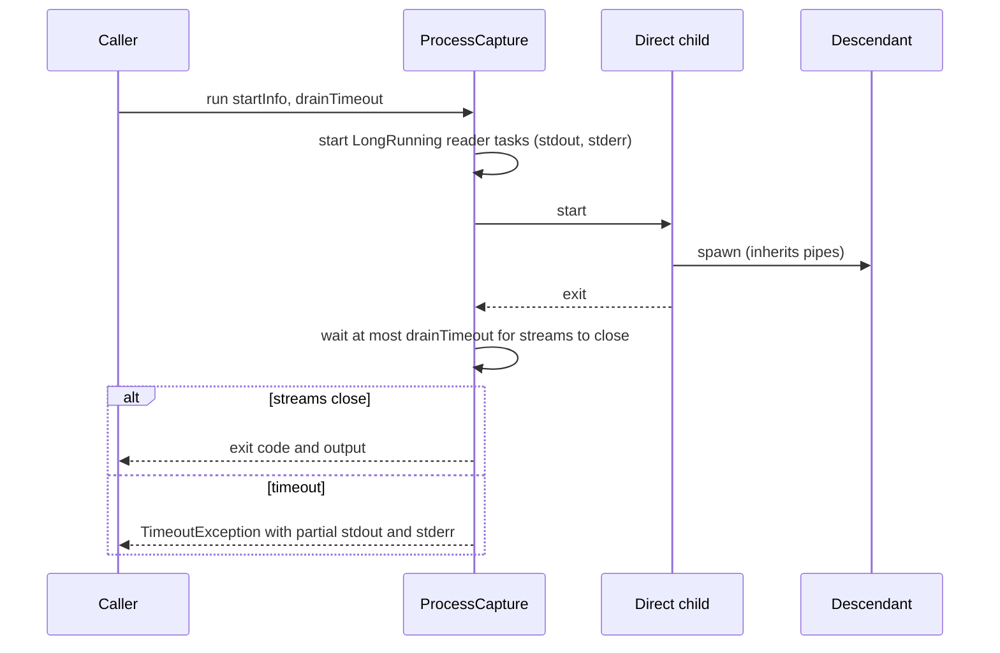

# Process capture

`ProcessCapture` in `tests/MiniScaffold.Tests/Infrastructure.fs` runs a child process and captures its output.
It does not hang when a descendant process keeps the output pipes open after the direct child exits.
`ProcessCaptureTests.fs` shows the old `ReadToEndAsync` capture hang in that case.



## Contract

- `runWithOutputAfterReaderSetup` reads each stream on a `LongRunning` task, so it does not need thread-pool workers.
- It copies output to the given writers and waits for the direct child.
- It waits at most `drainTimeout` for the streams to close. Otherwise it throws `TimeoutException` with the partial output.
- It collects writer faults into an `AggregateException`.
- `Builds.executeBuild` uses a 30 second drain:

```fsharp
let executeBuild workingDir testTarget =
    let destination = Path.Combine(diagnosticsRoot, Guid.NewGuid().ToString("N"))
    executeBuildWithDiagnostics destination (TimeSpan.FromSeconds 30.) workingDir testTarget
```

## Diagnostics retention

- Each generated build writes `command.txt`, `stdout.txt`, and `stderr.txt` under `TestResults/generated-builds/<guid>`.
- A successful build also writes `process.txt`.
- A failed build also copies nested `TestResults/**/*.trx`.
- CI uploads `TestResults/generated-builds/**` as test diagnostics.

## Test fixture

`Fixtures/ProcessCapture/Program.cs` is a C# program with modes such as `descendant`, `gated`, `exact`, `running`, and `faulting`.
`ProcessCaptureTests.fs` builds it from `ProcessCaptureFixture.csproj.template`.
The "no available pool workers" test starts the test assembly with the private `--miniscaffold-process-capture-starved-worker` argument (`Main.fs`).

`build/TestPartitions.ps1` has its own C# `PartitionOutputCapture` with a 30 second drain.

## Related

- [integration-tests.md](integration-tests.md)
- [../ci/workflows.md](../ci/workflows.md)
