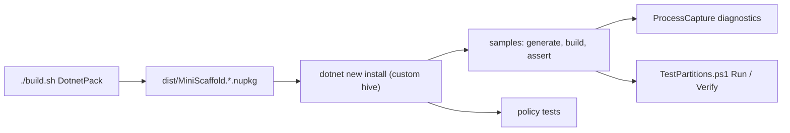

# Tests domain

The tests domain is `tests/MiniScaffold.Tests` and the partition scripts `build/TestPartitions.ps1` and `build/TestPartitions.Tests.ps1`.
The test project is an Expecto 10.2.2 `Exe` on net8.0. YoloDev.Expecto.TestSdk lets `dotnet test` run it.
The tests need a packed template package, so `IntegrationTests` depends on `DotnetPack`.



Command (`.github/workflows/build.yml`):

```bash
./build.sh IntegrationTests
```

Without a partition, this runs every test. The last unpartitioned CI run took 111 to 133 minutes on ubuntu and windows (build run 40257326330). Partitioned CI jobs take 13 to 29 minutes (build run 40426768755).

## Files

The compile order in `MiniScaffold.Tests.fsproj` is fixed: Infrastructure, ProcessCaptureTests, Asserts, Tests, ReleasePolicyTests, PackageDocumentTests, AuditPolicyTests, GeneratedReleasePolicyTests, FormattingTests, TrustedPublishingTests, Main.

| File | Role |
| --- | --- |
| `Infrastructure.fs` | `DisposableDirectory`, `Dotnet.New` with a custom hive, `ProcessCapture`, `Builds` |
| `Asserts.fs` | `Assert` checks and `Effect` steps on a generated repository |
| `Tests.fs` | The `samples` integration tests, `console archives`, and `metadata` |
| `ProcessCaptureTests.fs` | Tests for the process capture helper |
| `*PolicyTests.fs`, `FormattingTests.fs`, `PackageDocumentTests.fs` | Contract tests. See [policy-tests.md](policy-tests.md) |
| `Main.fs` | Entry point and the starved-worker mode |

## Topics

- [integration-tests.md](integration-tests.md) - the end-to-end flow of one `samples` case.
- [test-partitions.md](test-partitions.md) - how CI splits and verifies the tests.
- [process-capture.md](process-capture.md) - process execution, drain timeouts, and diagnostics.
- [policy-tests.md](policy-tests.md) - audit, release, trusted publishing, formatting, and package document contracts.

## Related

- [../build/fake-targets.md](../build/fake-targets.md)
- [../ci/workflows.md](../ci/workflows.md)
