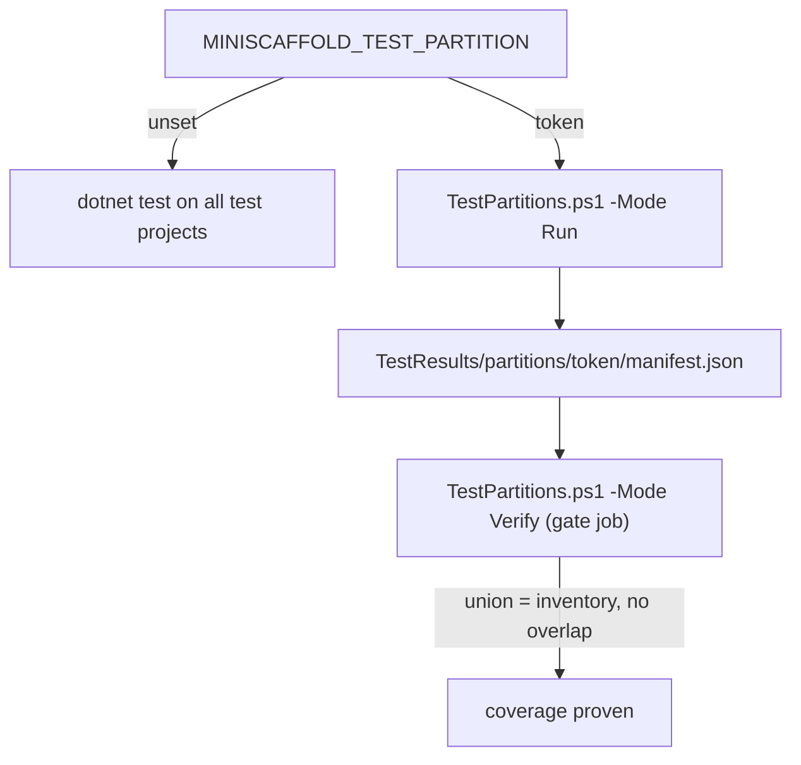

# Test partitions

CI splits the integration tests into partitions by `FullyQualifiedName` substring. A gate job then proves that the partitions cover every test exactly once.
`build/build.fs` selects the partition and `build/TestPartitions.ps1` runs and verifies it.

## Plan

`Get-PartitionPlan` in `build/TestPartitions.ps1`:

```powershell
'macOS-latest' {
    return @(
        @{ Token = 'generated-library-a'; Group = 'samples.generated builds.Library.A.'; Include = $true },
        @{ Token = 'generated-library-b'; Group = 'samples.generated builds.Library.B.'; Include = $true },
        @{ Token = 'generated-console'; Group = 'samples.generated builds.Console.'; Include = $true },
        @{ Token = 'sample-contracts'; Group = 'samples.contracts.'; Include = $true },
        @{ Token = 'other'; Group = 'samples.'; Include = $false }
    )
}
```

On `ubuntu-latest` and `windows-latest`, the plan is `generated-builds` (`samples.generated builds.`) and `other` (the complement).



## Run mode

`build.fs` maps `MINISCAFFOLD_TEST_PARTITION` to a case of `TestPartition`. An unknown value fails.
A partitioned run needs exactly one test project and `MINISCAFFOLD_TEST_OS`, `GITHUB_RUN_ID`, `GITHUB_RUN_ATTEMPT`, and `GITHUB_SHA`. In practice, only CI runs partitions.

`Run` mode:

1. Checks HEAD against `SourceRevision` and records a source fingerprint.
2. Lists the test inventory with `dotnet test --list-tests`.
3. Runs `dotnet test --no-build --no-restore --filter <canonical>` with `Expecto.fail-on-focused-tests=true` and a TRX logger.
4. Writes a schema version 2 `manifest.json` with a hash for each artifact.

## Verify mode

`Verify` checks, among other things:

- The worker matrix result is `success`.
- One manifest exists for each planned token, with no unknown or duplicate tokens.
- Run id, attempt, revision, configuration, OS, and partition match.
- Each TRX result is `Passed` and matches the selected set.
- Fingerprint, assembly, adapter, and SDK are the same across workers.
- The partitions do not overlap, and together they cover the full inventory.

A failure message tells the user to "Re-run all jobs", because bundles must come from one run attempt.

## Self-tests

`build/TestPartitions.Tests.ps1` builds synthetic bundles and runs positive and negative cases against `Verify`. The `verifier-controls` CI job runs it:

```bash
./build/TestPartitions.Tests.ps1 -ResultsDirectory "${{ runner.temp }}/verifier-controls"
```

## Invariants

- A new top-level group under `samples.`, or a `Library.C` group, breaks coverage. The self-tests check this case.
- A plan change must update `build/build.fs`, `build/TestPartitions.ps1`, `.github/workflows/build.yml`, and `build/TestPartitions.Tests.ps1` together.

## Related

- [integration-tests.md](integration-tests.md)
- [../ci/workflows.md](../ci/workflows.md)
